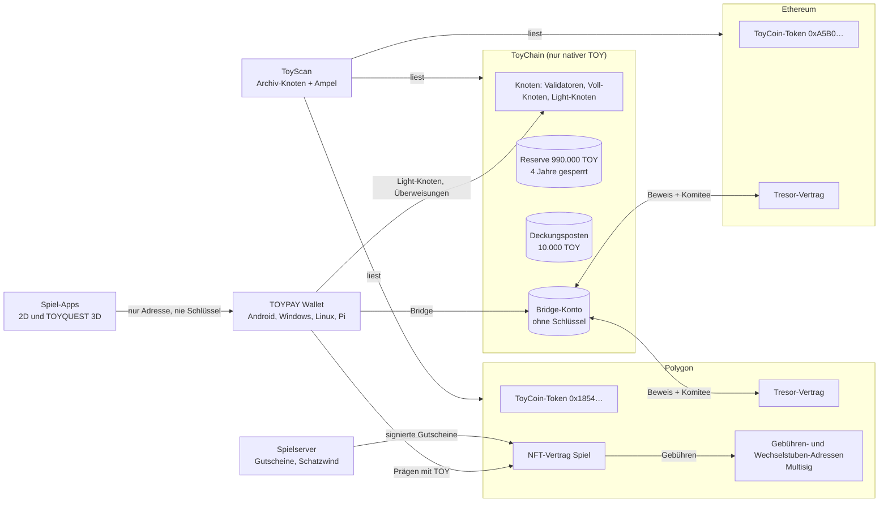

# Gesamtsystem: ToyChain, TOYPAY, Spiele, ToyScan und Bridge

Entwurf v0.1 vom 17.10.2026 · Fasst die Entscheidungen 1 bis 36 zusammen (`02-entscheidungen.md`) · Status: **zur Prüfung, mit offenen Entscheidungen in Abschnitt 10**

## 1. Die Teile auf einen Blick



| Teil | Aufgabe | Wo |
|---|---|---|
| **ToyChain** | Die maßgebliche Kette. Nur der native Coin TOY, keine Token, keine Verträge (Nr. 36) | eigene Knoten |
| **TOYPAY Wallet** | Wallet und Knoten für TOY auf allen Ketten, Bridge, Prägen. Ab 18 (Nr. 31, 32) | Android, Windows, Linux, Raspberry Pi |
| **Spiel-Apps** | 2D-Spiele (Stadtviertel, Poker mit Basar-Chips, TOYQUEST) und TOYQUEST 3D. Ab 16 | dieselben vier Plattformen |
| **Spielserver** | Spielstände, Dukaten-Konten, Gutscheine fürs Prägen, Schatzwind | Server des Projekts |
| **ToyScan** | Explorer und Ampel, liest alle drei Ketten | Archiv-Knoten + Web |
| **Bridge** | TOY 1:1 zwischen ToyChain und den Token auf Polygon und Ethereum | ToyChain-Transaktionsart + Tresor-Verträge |
| **NFT-Vertrag** | Spielfiguren und Gegenstände als NFTs | Polygon |

## 2. Wer vertraut wem

| Beziehung | Was übertragen wird | Schutz |
|---|---|---|
| Wallet ↔ ToyChain | Transaktionen, Blöcke | Light-Knoten prüft Sammelsignaturen selbst |
| Spiel ↔ Wallet | **nur die Adresse** und Signaturen, die der Nutzer in der Wallet bestätigt | Das Spiel sieht nie Schlüssel oder Phrase |
| Spielserver → NFT-Vertrag | Gutschein „Gegenstand X für Adresse Y, Gebühr Z“ | eigener Gutschein-Schlüssel, Gebühr 1–100 TOY, Tages- und Wochenlimits, Notschalter |
| ToyChain ↔ Tresore | Freigaben in beide Richtungen | zk-Beweis **und** Komitee-Schwellensignatur (Nr. 5) |
| ToyScan → alle | nur lesen | offene Regeln, jeder kann nachrechnen |

## 3. Alle Konten und Adressen

### ToyChain (protokolleigene Konten haben keinen Schlüssel)

| Konto | Inhalt beim Start | Wer kann es bewegen |
|---|---|---|
| **Reserve** (höchstens 100 Wallets) | zusammen **990.000 TOY** | die Inhaber, aber nur den freigegebenen Teil: linear über **1.460 Epochen** (4 Jahre zu je 365 Epochen) |
| **Deckungsposten Polygon** | **10.000 TOY** im Bridge-Konto, markiert als Deckung des Fremdbestands | nur das Protokoll (Bridge-Eingang) |
| **Bridge-Konto** | die 10.000 TOY Deckung, später alle gebridgten TOY | nur die Transaktionsarten Bridge-Ausgang/-Eingang |
| **Erstattungs-Pool** | 0, füllt sich aus 10 % der Emission und 40 % der Gebühren | nur das Protokoll |
| **Emission** | kein Konto: 99.000.000 TOY entstehen erst nach und nach, je Epoche `k × Restmenge` | nur das Protokoll |

### Polygon

| Adresse | Rolle |
|---|---|
| `0x1854b69c…A5BF` | ToyCoin-Token (ERC-20, ohne Mint, ohne Admin) |
| `0x18da0be9…00c2` | Ersteller-Adresse: hält 97.999.000 TOY. **Keine Abgänge mehr** bis zur Tresor-Einzahlung (Nr. 17) |
| Tresor-Vertrag (neu) | nimmt den Bestand der Ersteller-Adresse auf, gibt nur gegen ToyChain-Beweis frei |
| NFT-Vertrag (neu) | Prägen mit Gutschein, Sperre 10 TOY / 20 Tage, Auflage Sternenfeuer 1.001 |
| Gebühren-Adresse (neu, Multisig) | empfängt Präge-Gebühren (Nr. 26) |
| Wechselstuben-Adresse (neu, Multisig) | empfängt TOY für Sultansdukaten (Nr. 28) |
| Relayer (neu) | zahlt später Gas für Prägungen mit Dukaten. Hält nur POL und kleine Beträge |

### Ethereum

| Adresse | Rolle |
|---|---|
| `0xA5B04ce6…678A` | ToyCoin-Token (ERC-20, ohne Mint, ohne Admin) |
| `0x18da0be9…00c2` | Ersteller-Adresse: hält alle 100.000.000 TOY, nie bewegt |
| Tresor-Vertrag (neu) | wie auf Polygon |

## 4. Der Genesis-Block

Der Genesis-Block ist der erste Block der Kette. **Er lässt sich nach dem Start nie mehr ändern.**

| Inhalt | Wert | Quelle |
|---|---|---|
| Chain-ID | **offen** (Abschnitt 10). Muss eindeutig sein, Testnet und Mainnet bekommen verschiedene IDs | — |
| Obergrenze | 10^26 kleinste Einheiten = 100.000.000 TOY, im Code fest | Spezifikation 14 |
| Reserve | 990.000 TOY auf höchstens 100 öffentlich gelisteten Adressen, je Adresse ein Freigabeplan über 1.460 Epochen | Nr. 3, 10, 14 |
| Deckungsposten | 10.000 TOY im Bridge-Konto, Zweck „Polygon-Fremdbestand“ | Nr. 13, 14 |
| Bestand beim Start | **1.000.000 TOY** (990.000 + 10.000) | — |
| Emissionsrest | 99.000.000 TOY, noch nicht vorhanden | Spezifikation 10 |
| Emission | k₀ = 0,0505 % je Epoche, m ∈ [0,5; 2,0], erste Epoche ca. 49.995 TOY | Nr. 9 |
| Zeit | Blockzeit 60 s (frühestens 10 s), Epoche = 1.440 Blöcke, 1 Jahr = 365 Epochen | Nr. 11 |
| Gebühren | Kontingent 10–100 je Epoche, progressive Gebühr, ToyWork Argon2id 16 MiB, Vielnutzer ab 1.000 | Spezifikation 6, 7 |
| Mindestguthaben | 0,1 TOY. Kontoablauf nach 1.001 Tagen unter einer Schwelle | Nr. 1 |
| Start-Validatoren | **offen** (Abschnitt 10) | — |
| Prüfsumme | Hash des Genesis-Blocks wird veröffentlicht: auf GitHub, in ToyScan und in jeder Wallet. Er ist der erste Checkpoint | Spezifikation 5 |

**Rechenprobe:** gemintet (0) + Reserve (990.000) + Deckung (10.000) = 1.000.000 ≤ 100.000.000. Nach 25 Jahren bei m = 1: rund 98,0 Mio. gemintet + 1 Mio. = rund 99,0 Mio., die Obergrenze bleibt unerreicht.

## 5. Reihenfolge bis zum Start

Schritte mit 🔒 lassen sich **nicht rückgängig machen**.

| Nr. | Schritt | Voraussetzung | Prüfung |
|---|---|---|---|
| 0 | **Sofort:** Ersteller-Adresse auf eine Hardware-Wallet bringen. Keine Abgänge mehr | — | ToyScan-Skript zeigt Abgänge |
| 1 | Rückübertragung von `0xd908…`, `0x6b9a…`, `0x856d…` an die Ersteller-Adresse, erst ein Testbetrag | 0 | Fremdbestand Polygon ≤ 10.000 TOY |
| 2 | Quellcode der beiden Token-Verträge auf Polygonscan und Etherscan verifizieren | Original-Quellcode | Häkchen „Verified“ |
| 3 | Phase 1 bauen (M1–M10), öffentliches Testnet | — | Fertig-Kriterien des Bauplans |
| 4 | Externes Audit von Kryptografie und Konsens | 3 | Bericht veröffentlicht |
| 5 | Rechtliche Prüfung (MiCA, Steuer, Glücksspiel/Jugendschutz für TOYPAY, Reserve) | — | Gutachten |
| 6 | Stichtag: Fremdbestand messen (Polygon ≤ 10.000, Ethereum 0) | 1 | Messprotokoll in ToyScan |
| 7 | 🔒 **Genesis-Block erzeugen** und Hash veröffentlichen | 4, 5, 6 | mehrere Personen erzeugen ihn unabhängig und vergleichen den Hash |
| 8 | Mainnet-Start mit den Start-Validatoren | 7 | Blöcke, Finalität |
| 9 | ToyScan live. Kriterien zur Bridge zeigen „noch nicht aktiv“ (grau) | 8 | Ampel |
| 10 | Tresor-Verträge und Bridge-Komitee: bauen, Audit, Testnet | Phase 2 (Beweise) | Audit |
| 11 | 🔒 **Ersteller-Adresse zahlt ihren Bestand in die Tresore ein** | 10 | ToyScan: Ersteller-Adresse leer, Tresore voll |
| 12 | Bridge-Start | 11 | Ampel grün |
| 13 | NFT-Prägung mit TOY startet (Nr. 17) | 12 | NFT-Vertrag-Audit |

## 6. Die Deckung über alle Ketten (Buchhaltung)

**Bezeichnungen**
- `G` = gemintetes TOY, `R` = Reserve (990.000), `C` = Deckungsposten (10.000)
- `K` = Bestand im Bridge-Konto auf ToyChain
- `U_P`, `U_E` = ToyCoin-Token **im Umlauf** auf Polygon bzw. Ethereum, also außerhalb von Tresor und Ersteller-Adresse
- `F_P` = Fremdbestand Polygon (≤ 10.000), `A_P`, `A_E` = vom Tresor freigegebene Token

**Regeln, die immer gelten müssen**

| Nr. | Regel | Bedeutung |
|---|---|---|
| I1 | `G + R + C ≤ 10^26` | Die Obergrenze hält auf ToyChain |
| I2 | `K = C + (Σ Bridge-Ausgang) − (Σ Bridge-Eingang)` | Das Bridge-Konto enthält genau die Deckung plus alles, was hinausgebridgt wurde |
| I3 | `U_P + U_E ≤ K` | Jeder Token im Umlauf auf Polygon und Ethereum ist durch natives TOY gedeckt |
| I4 | `U_P = F_P + A_P` und `U_E = A_E` | Umlauf = Fremdbestand + Freigaben |
| I5 | `F_P ≤ C` | Der Fremdbestand ist vollständig gedeckt (Nr. 14) |
| I6 | TOY im Umlauf auf allen Ketten `≤ G + R + C ≤ 100 Mio.` | globale Supply-Regel (Spezifikation 12) |

**Beispiel:** Anna bridgt 500 TOY nach Polygon. Auf ToyChain wandern 500 TOY ins Bridge-Konto (K: 10.000 → 10.500), auf Polygon gibt der Tresor 500 Token frei (A_P = 500). Dann gilt U_P = 7.700 + 500 = 8.200 ≤ K = 10.500. Bob, der noch alte Token hat, bridgt 1.000 zurück: K sinkt auf 9.500, U_P auf 7.200. Die Regel I3 hält weiter, und Anna kann jederzeit zurück.

ToyScan rechnet I1 bis I6 live nach. Jede Verletzung färbt die Ampel rot (Abschnitt 9).

## 7. Wertflüsse im Spiel

```
TOY (Polygon) ──► Wechselstube (Multisig) ──► Sultansdukaten (Konto, nicht übertragbar)
                                                    │
TOY (Polygon) ──► Präge-Gebühr ──► Gebühren-Adresse (Multisig)   ◄──┘ (später über den Relayer)
                                         │
                                         └─► Haushaltsregel: Schatzwind der nächsten Woche
                                               └─► Funde im Spiel als Königsdukaten, Gold, Gegenstände
                                                     (nie zurück in TOY, Nr. 25)
```

- **Sperre:** 10 TOY je NFT liegen 20 Tage im NFT-Vertrag und gehören dem Präger. Der Notschalter kann das Abholen nie blockieren.
- **Spielwährungen** liegen nur auf dem Spielserver, nicht auf einer Kette.
- **Keine Rückflüsse in TOY:** Weder Dukaten noch Gold werden je zu TOY. NFTs verkaufen Spieler auf Marktplätzen zu einem Preis, den sie selbst aushandeln.

## 8. Schlüssel und ihre Sicherung

| Schlüssel | Was er kann | Sicherung (Vorschlag) |
|---|---|---|
| Ersteller-Adresse | 198 Mio. Token auf zwei Ketten bewegen, bis zur Tresor-Einzahlung | Hardware-Wallet, offline, Phrase an zwei getrennten Orten |
| Reserve-Wallets | den freigegebenen Teil der Reserve bewegen | Hardware-Wallets, Liste öffentlich |
| Gebühren- und Wechselstuben-Adresse | Gebühren und Wechselstuben-TOY bewegen | Multisig **3 von 5**, getrennte Personen und Geräte |
| Bridge-Komitee | zweite Sicherung neben dem Beweis | Schwellensignatur, z. B. **5 von 9** unabhängige Betreiber |
| Spielserver-Gutschein | Gutscheine fürs Prägen ausstellen | eigener Schlüssel nur dafür, in einem Hardware-Sicherheitsmodul, Limits im Vertrag |
| Relayer | Gas bezahlen | Hot-Wallet mit kleinem POL-Bestand, täglich nachgefüllt |
| Validatoren | Blöcke signieren | BLS-Schlüssel, Slashing bei Doppelsignatur |

**Grundsatz:** Kein einzelner Schlüssel darf neues TOY erzeugen, Tresore leeren oder die Regeln ändern. Das kann nur das Protokoll bzw. der jeweilige Vertrag ohne Admin.

## 9. Was ToyScan prüft

| Kriterium (Spezifikation 12) | Datenquelle | Vor dem Bridge-Start |
|---|---|---|
| 1 Umlauf ≤ gemintet + Reserve ≤ 100 Mio. | ToyChain-Zustand + beide Token-Verträge | aktiv |
| 2 Tresore halten den nicht freigegebenen Rest | Tresor-Bestände, Bridge-Konto | grau |
| 3 Reserve ≤ 990.000 TOY in ≤ 100 Wallets, Zeitsperre intakt | Genesis-Liste + Zustand | aktiv |
| 4 Emission nicht vor dem Zeitplan | Emissionszähler je Epoche | aktiv |
| 5 Altbestand-Verträge ohne Mint und Upgrade, Gesamtmenge ≤ 100 Mio., Tresore ohne Admin | Bytecode, Code-Hash, `totalSupply()` | aktiv (Tresor-Teil grau) |
| 6 Notschalter nicht ausgelöst, Beweis-Verifizierer aktuell | Tresor-Verträge | grau |
| 7 Fremdbestand je Kette ≤ Deckungsposten | Token-Verträge, Ersteller- und Tresor-Bestände | aktiv |
| neu: Ersteller-Adresse ohne Abgänge | Polygon und Ethereum | aktiv bis zur Tresor-Einzahlung |
| neu: Regeln I1 bis I6 | alle Ketten | aktiv |

Details folgen in `08-toyscan.md`.

## 10. Offene Entscheidungen

**E1 · Wer validiert am Anfang?**
Proof-of-Stake braucht gebundenes TOY. Beim Start gibt es aber nur die Reserve (990.000) und die Deckung. Ohne Lösung würden anfangs nur Reserve-Inhaber die Kette sichern, und die Kette wäre zentralisiert.
**Vorschlag:**
- Ein offengelegtes **Start-Komitee** von 7 bis 21 Knoten verschiedener Betreiber. Sie staken gesperrte Reserve-TOY, und die Zeitsperre bleibt dabei bestehen.
- **Reserve-Stake bekommt keine Emission.** Der Anteil der Start-Validatoren fließt in den Erstattungs-Pool. So bereichert sich niemand am Start.
- Ab Epoche 1 verdienen alle über **ToyWork** (40 % der Emission) und Attestierung. Wer TOY verdient hat, kann selbst staken.
- **Übergabe:** Sobald unabhängiger Stake das Start-Komitee übersteigt (z. B. 3-mal so viel), scheidet das Start-Komitee schrittweise aus. ToyScan zeigt den Grad der Dezentralisierung an (wie viele Teilnehmer zusammen ein Drittel des Stakes halten).

**E2 · Mainnet vor oder nach Phase 2 (Beweise)?**
Ohne die Beweis-Schicht müssen Knoten alte Block-Header behalten oder **Checkpoints vertrauen**. Header wachsen um ca. 158 MB pro Jahr (525.600 Blöcke à 300 Byte). Das 256-MB-Budget wäre damit nach gut einem Jahr überschritten.
- (a) **Mainnet nach Phase 1 und Audit.** Knoten starten von veröffentlichten Checkpoints, alte Header liegen nur auf Archiv-Knoten. Phase 2 muss dann innerhalb von etwa 12 Monaten folgen. Bis dahin vertrauen neue Knoten den Checkpoints.
- (b) **Mainnet erst nach Phase 2.** Das ist sauberer, aber deutlich später, denn Phase 2 ist Forschungsarbeit.

**E3 · Reihenfolge der Phasen 3 bis 5**
Laut Fahrplan kommt die Bridge erst nach Privatsphäre (Phase 3) und Offline-Schecks (Phase 4). Die NFT-Prägung mit TOY wartet aber auf die Bridge (Nr. 17). **Vorschlag:** Bridge als Phase 3 vorziehen, danach Privatsphäre und Offline-Schecks.

**E4 · Chain-ID**
Die Chain-ID muss weltweit eindeutig sein, damit Signaturen nicht auf anderen Ketten gelten. Vor dem Testnet wird eine freie Nummer gewählt und gegen die öffentlichen Listen geprüft. Testnet und Mainnet bekommen verschiedene IDs.

**E5 · Reserve-Wallets**
Wer erhält wie viel der 990.000 TOY, z. B. Team, Entwickler, Bug-Bounty-Topf? Die Liste ist Teil des Genesis-Blocks und danach nicht mehr änderbar.

**E6 · Auflage Rubinglut**
Gibt es für Gegenstände von 40 bis 79 TOY ebenfalls eine Auflage, z. B. 10.001 Stück je Art?
