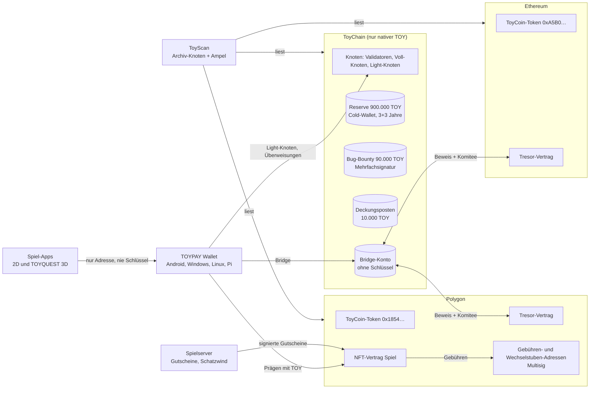

# Gesamtsystem: ToyChain, TOYPAY, Spiele, ToyScan und Bridge

Entwurf v0.3 vom 17.10.2026 · Fasst die Entscheidungen 1 bis 45 zusammen (`02-entscheidungen.md`) · Status: **zur Prüfung, mit offenen Entscheidungen in Abschnitt 10**

## 1. Die Teile auf einen Blick



| Teil | Aufgabe | Wo |
|---|---|---|
| **ToyChain** | Die maßgebliche Kette. Nur der native Coin TOY, keine Token, keine Verträge (Nr. 36) | eigene Knoten |
| **TOYPAY Wallet** | Wallet und Knoten für TOY auf allen Ketten, Bridge, Prägen. Ab 18 (Nr. 31, 32) | Android, Windows, Linux, Raspberry Pi |
| **Spiel-Apps** | 2D-Spiele (Stadtviertel, Poker mit Basar-Chips, TOYQUEST) und TOYQUEST 3D. Ab 16 | dieselben vier Plattformen |
| **Spielserver** | Spielstände, Dukaten-Konten, Gutscheine fürs Prägen, Schatzwind | Server des Projekts |
| **ToyScan** | Explorer und Ampel, liest alle drei Ketten | Archiv-Knoten + Web |
| **Bridge** | TOY 1:1 zwischen ToyChain und den Token auf Polygon und Ethereum | ToyChain-Transaktionsart + Tresor-Verträge |
| **NFT-Vertrag** | Spielfiguren und Gegenstände als NFTs | Polygon |

## 2. Wer vertraut wem

| Beziehung | Was übertragen wird | Schutz |
|---|---|---|
| Wallet ↔ ToyChain | Transaktionen, Blöcke | Light-Knoten prüft Sammelsignaturen selbst |
| Spiel ↔ Wallet | **nur die Adresse** und Signaturen, die der Nutzer in der Wallet bestätigt | Das Spiel sieht nie Schlüssel oder Phrase |
| Spielserver → NFT-Vertrag | Gutschein „Gegenstand X für Adresse Y, Gebühr Z“ | eigener Gutschein-Schlüssel, Gebühr 1–100 TOY, Tages- und Wochenlimits, Notschalter |
| ToyChain ↔ Tresore | Freigaben in beide Richtungen | zk-Beweis **und** Komitee-Schwellensignatur (Nr. 5) |
| ToyScan → alle | nur lesen | offene Regeln, jeder kann nachrechnen |

## 3. Alle Konten und Adressen

### ToyChain (protokolleigene Konten haben keinen Schlüssel)

| Konto | Inhalt beim Start | Wer kann es bewegen |
|---|---|---|
| **Reserve** auf der offiziellen Cold-Wallet des Erstellers (Nr. 41, 44) | **900.000 TOY** | nur der freigegebene Teil: **nichts in den ersten 1.095 Epochen** (3 Jahre), danach je Epoche gleichmäßig über 1.095 Epochen (rund 822 TOY pro Epoche, voll frei nach 6 Jahren, Nr. 42). Delegieren an das Start-Komitee ist auch gesperrt möglich (Nr. 37) |
| **Bug-Bounty-Topf** (Mehrfachsignatur-Konto, Nr. 43) | **90.000 TOY** | sofort verfügbar, nur mit z. B. 3 von 5 Unterschriften. Prämien über 5.000 TOY nach Abstimmung (Nr. 45) |
| **Deckungsposten Polygon** | **10.000 TOY** im Bridge-Konto, markiert als Deckung des Fremdbestands | nur das Protokoll (Bridge-Eingang) |
| **Bridge-Konto** | die 10.000 TOY Deckung, später alle gebridgten TOY | nur die Transaktionsarten Bridge-Ausgang/-Eingang |
| **Erstattungs-Pool** | 0, füllt sich aus 10 % der Emission und 40 % der Gebühren | nur das Protokoll |
| **Emission** | kein Konto: 99.000.000 TOY entstehen erst nach und nach, je Epoche `k × Restmenge` | nur das Protokoll |

### Polygon

| Adresse | Rolle |
|---|---|
| `0x1854b69c…A5BF` | ToyCoin-Token (ERC-20, ohne Mint, ohne Admin) |
| `0x18da0be9…00c2` | Ersteller-Adresse: hält 97.999.000 TOY. Abgänge nur an die offizielle Cold-Wallet oder den Tresor (Nr. 17, 44) |
| Offizielle Cold-Wallet Polygon (neu, öffentlich) | übernimmt den Bestand der Ersteller-Adresse bis zur Tresor-Einzahlung. Zählt nicht zum Fremdbestand |
| Tresor-Vertrag (neu) | nimmt den Bestand der Ersteller-Adresse auf, gibt nur gegen ToyChain-Beweis frei |
| NFT-Vertrag (neu) | Prägen mit Gutschein, Sperre 10 TOY / 20 Tage, Auflage Sternenfeuer 1.001 |
| Gebühren-Adresse (neu, Multisig) | empfängt Präge-Gebühren (Nr. 26) |
| Wechselstuben-Adresse (neu, Multisig) | empfängt TOY für Sultansdukaten (Nr. 28) |
| Relayer (neu) | zahlt später Gas für Prägungen mit Dukaten. Hält nur POL und kleine Beträge |

### Ethereum

| Adresse | Rolle |
|---|---|
| `0xA5B04ce6…678A` | ToyCoin-Token (ERC-20, ohne Mint, ohne Admin) |
| `0x18da0be9…00c2` | Ersteller-Adresse: hält alle 100.000.000 TOY, nie bewegt |
| Offizielle Cold-Wallet Ethereum (neu, öffentlich) | übernimmt den Bestand bis zur Tresor-Einzahlung |
| Tresor-Vertrag (neu) | wie auf Polygon |

## 4. Der Genesis-Block

Der Genesis-Block ist der erste Block der Kette. **Er lässt sich nach dem Start nie mehr ändern.**

| Inhalt | Wert | Quelle |
|---|---|---|
| Chain-ID | wird vor dem Testnet gewählt und gegen die öffentlichen Listen geprüft. Testnet und Mainnet bekommen verschiedene IDs | Nr. 40 |
| Obergrenze | 10^26 kleinste Einheiten = 100.000.000 TOY, im Code fest | Spezifikation 14 |
| Reserve | 900.000 TOY auf der offiziellen Cold-Wallet (Freigabeplan: 3 Jahre nichts, dann je Epoche über 3 Jahre) und 90.000 TOY Bug-Bounty-Topf auf dem Mehrfachsignatur-Konto | Nr. 14, 41–44 |
| Deckungsposten | 10.000 TOY im Bridge-Konto, Zweck „Polygon-Fremdbestand“ | Nr. 13, 14 |
| Bestand beim Start | **1.000.000 TOY** (900.000 Reserve + 90.000 Bug-Bounty + 10.000 Deckung) | — |
| Emissionsrest | 99.000.000 TOY, noch nicht vorhanden | Spezifikation 10 |
| Emission | k₀ = 0,0505 % je Epoche, m ∈ [0,5; 2,0], erste Epoche ca. 49.995 TOY | Nr. 9 |
| Zeit | Blockzeit 60 s (frühestens 10 s), Epoche = 1.440 Blöcke, 1 Jahr = 365 Epochen | Nr. 11 |
| Gebühren | Kontingent 10–100 je Epoche, progressive Gebühr, ToyWork Argon2id 16 MiB, Vielnutzer ab 1.000 | Spezifikation 6, 7 |
| Mindestguthaben | 0,1 TOY. Kontoablauf nach 1.001 Tagen unter einer Schwelle | Nr. 1 |
| Start-Validatoren | Start-Komitee aus 7 bis 21 offengelegten Betreibern mit delegiertem Reserve-Stake, ohne Emission für diesen Stake | Nr. 37 |
| Prüfsumme | Hash des Genesis-Blocks wird veröffentlicht: auf GitHub, in ToyScan und in jeder Wallet. Er ist der erste Checkpoint | Spezifikation 5 |

**Rechenprobe:** gemintet (0) + Reserve (900.000) + Bug-Bounty (90.000) + Deckung (10.000) = 1.000.000 ≤ 100.000.000. Nach 25 Jahren bei m = 1: rund 98,0 Mio. gemintet + 1 Mio. = rund 99,0 Mio., die Obergrenze bleibt unerreicht.

## 5. Reihenfolge bis zum Start

Schritte mit 🔒 lassen sich **nicht rückgängig machen**.

| Nr. | Schritt | Voraussetzung | Prüfung |
|---|---|---|---|
| 0 | **Sofort:** offizielle Cold-Wallets für Polygon und Ethereum anlegen, öffentlich bekanntgeben und mit einer signierten Nachricht der Ersteller-Adresse belegen. Bestände dorthin übertragen (Nr. 44). Sonst keine Abgänge | — | ToyScan zeigt jeden Abgang, der nicht an eine offizielle Cold-Wallet geht |
| 1 | Rückübertragung von `0xd908…`, `0x6b9a…`, `0x856d…` an die Ersteller-Adresse, erst ein Testbetrag | 0 | Fremdbestand Polygon ≤ 10.000 TOY |
| 2 | Quellcode der beiden Token-Verträge auf Polygonscan und Etherscan verifizieren | Original-Quellcode | Häkchen „Verified“ |
| 3 | Phase 1 bauen (M1–M10), öffentliches Testnet | — | Fertig-Kriterien des Bauplans |
| 4 | Externes Audit von Kryptografie und Konsens | 3 | Bericht veröffentlicht |
| 5 | Rechtliche Prüfung (MiCA, Steuer, Glücksspiel/Jugendschutz für TOYPAY, Reserve) | — | Gutachten |
| 6 | Stichtag: Fremdbestand messen (Polygon ≤ 10.000, Ethereum 0) | 1 | Messprotokoll in ToyScan |
| 7 | 🔒 **Genesis-Block erzeugen** und Hash veröffentlichen | 4, 5, 6 | mehrere Personen erzeugen ihn unabhängig und vergleichen den Hash |
| 8 | Mainnet-Start mit dem Start-Komitee (Nr. 37). Neue Knoten starten von Checkpoints (Nr. 38) | 7 | Blöcke, Finalität |
| 8a | Phase 2 (Beweise) innerhalb von etwa 12 Monaten | 8 | Header-Speicher wächst nicht weiter |
| 9 | ToyScan live. Kriterien zur Bridge zeigen „noch nicht aktiv“ (grau) | 8 | Ampel |
| 10 | Phase 3 Bridge (Nr. 39): Tresor-Verträge und Bridge-Komitee bauen, Audit, Testnet | 8a | Audit |
| 11 | 🔒 **Die offiziellen Cold-Wallets zahlen ihren Bestand in die Tresore ein** | 10 | ToyScan: Cold-Wallets leer, Tresore voll |
| 12 | Bridge-Start | 11 | Ampel grün |
| 13 | NFT-Prägung mit TOY startet (Nr. 17) | 12 | NFT-Vertrag-Audit |

## 6. Die Deckung über alle Ketten (Buchhaltung)

**Bezeichnungen**
- `G` = gemintetes TOY, `R` = Reserve einschließlich Bug-Bounty-Topf (990.000), `C` = Deckungsposten (10.000)
- `K` = Bestand im Bridge-Konto auf ToyChain
- `U_P`, `U_E` = ToyCoin-Token **im Umlauf** auf Polygon bzw. Ethereum, also außerhalb von Tresor, Ersteller-Adresse und offiziellen Cold-Wallets
- `F_P` = Fremdbestand Polygon (≤ 10.000), `A_P`, `A_E` = vom Tresor freigegebene Token

**Regeln, die immer gelten müssen**

| Nr. | Regel | Bedeutung |
|---|---|---|
| I1 | `G + R + C ≤ 10^26` | Die Obergrenze hält auf ToyChain |
| I2 | `K = C + (Σ Bridge-Ausgang) − (Σ Bridge-Eingang)` | Das Bridge-Konto enthält genau die Deckung plus alles, was hinausgebridgt wurde |
| I3 | `U_P + U_E ≤ K` | Jeder Token im Umlauf auf Polygon und Ethereum ist durch natives TOY gedeckt |
| I4 | `U_P = F_P + A_P` und `U_E = A_E` | Umlauf = Fremdbestand + Freigaben |
| I5 | `F_P ≤ C` | Der Fremdbestand ist vollständig gedeckt (Nr. 14) |
| I6 | TOY im Umlauf auf allen Ketten `≤ G + R + C ≤ 100 Mio.` | globale Supply-Regel (Spezifikation 12) |

**Beispiel:** Anna bridgt 500 TOY nach Polygon. Auf ToyChain wandern 500 TOY ins Bridge-Konto (K: 10.000 → 10.500), auf Polygon gibt der Tresor 500 Token frei (A_P = 500). Dann gilt U_P = 7.700 + 500 = 8.200 ≤ K = 10.500. Bob, der noch alte Token hat, bridgt 1.000 zurück: K sinkt auf 9.500, U_P auf 7.200. Die Regel I3 hält weiter, und Anna kann jederzeit zurück.

ToyScan rechnet I1 bis I6 live nach. Jede Verletzung färbt die Ampel rot (Abschnitt 9).

## 7. Wertflüsse im Spiel

```
TOY (Polygon) ──► Wechselstube (Multisig) ──► Sultansdukaten (Konto, nicht übertragbar)
                                                    │
TOY (Polygon) ──► Präge-Gebühr ──► Gebühren-Adresse (Multisig)   ◄──┘ (später über den Relayer)
                                         │
                                         └─► Haushaltsregel: Schatzwind der nächsten Woche
                                               └─► Funde im Spiel als Königsdukaten, Gold, Gegenstände
                                                     (nie zurück in TOY, Nr. 25)
```

- **Sperre:** 10 TOY je NFT liegen 20 Tage im NFT-Vertrag und gehören dem Präger. Der Notschalter kann das Abholen nie blockieren.
- **Spielwährungen** liegen nur auf dem Spielserver, nicht auf einer Kette.
- **Keine Rückflüsse in TOY:** Weder Dukaten noch Gold werden je zu TOY. NFTs verkaufen Spieler auf Marktplätzen zu einem Preis, den sie selbst aushandeln.

## 8. Schlüssel und ihre Sicherung

| Schlüssel | Was er kann | Sicherung (Vorschlag) |
|---|---|---|
| Ersteller-Adresse und offizielle Cold-Wallets | Altbestand-Token bis zur Tresor-Einzahlung; die gesperrte Reserve auf ToyChain empfangen und delegieren | **Cold-Wallets**: Schlüssel nie auf einem Gerät mit Internet, Phrase doppelt an getrennten sicheren Orten. Adressen öffentlich, Zugehörigkeit per signierter Nachricht belegt (Nr. 44) |
| Bug-Bounty-Topf | 90.000 TOY auszahlen | Mehrfachsignatur-Konto 3 von 5, Auszahlungen öffentlich |
| Gebühren- und Wechselstuben-Adresse | Gebühren und Wechselstuben-TOY bewegen | Multisig **3 von 5**, getrennte Personen und Geräte |
| Bridge-Komitee | zweite Sicherung neben dem Beweis | Schwellensignatur, z. B. **5 von 9** unabhängige Betreiber |
| Spielserver-Gutschein | Gutscheine fürs Prägen ausstellen | eigener Schlüssel nur dafür, in einem Hardware-Sicherheitsmodul, Limits im Vertrag |
| Relayer | Gas bezahlen | Hot-Wallet mit kleinem POL-Bestand, täglich nachgefüllt |
| Validatoren | Blöcke signieren | BLS-Schlüssel, Slashing bei Doppelsignatur |

**Grundsatz:** Kein einzelner Schlüssel darf neues TOY erzeugen, Tresore leeren oder die Regeln ändern. Das kann nur das Protokoll bzw. der jeweilige Vertrag ohne Admin.

## 9. Was ToyScan prüft

| Kriterium (Spezifikation 12) | Datenquelle | Vor dem Bridge-Start |
|---|---|---|
| 1 Umlauf ≤ gemintet + Reserve ≤ 100 Mio. | ToyChain-Zustand + beide Token-Verträge | aktiv |
| 2 Tresore halten den nicht freigegebenen Rest | Tresor-Bestände, Bridge-Konto | grau |
| 3 Reserve 900.000 TOY auf der Cold-Wallet mit Freigabeplan, Bug-Bounty-Topf 90.000 TOY, Deckung 10.000 TOY | Genesis-Block + Zustand | aktiv |
| 4 Emission nicht vor dem Zeitplan | Emissionszähler je Epoche | aktiv |
| 5 Altbestand-Verträge ohne Mint und Upgrade, Gesamtmenge ≤ 100 Mio., Tresore ohne Admin | Bytecode, Code-Hash, `totalSupply()` | aktiv (Tresor-Teil grau) |
| 6 Notschalter nicht ausgelöst, Beweis-Verifizierer aktuell | Tresor-Verträge | grau |
| 7 Fremdbestand je Kette ≤ Deckungsposten | Token-Verträge, Ersteller- und Tresor-Bestände | aktiv |
| neu: Ersteller-Adresse und Cold-Wallets nur mit erlaubten Abgängen | Polygon und Ethereum | aktiv bis zur Tresor-Einzahlung |
| neu: Regeln I1 bis I6 | alle Ketten | aktiv |

Details folgen in `08-toyscan.md`.

## 10. Entscheidungen vom 17.10.2026 und was noch offen ist

| Nr. | Thema | Entscheidung |
|---|---|---|
| 37 (E1) | Start-Validatoren | Start-Komitee aus 7 bis 21 offengelegten Betreibern mit delegiertem Reserve-Stake. Kein Emissionsanteil für Reserve-Stake. Übergabe, sobald unabhängiger Stake z. B. das Dreifache erreicht |
| 38 (E2) | Mainnet-Zeitpunkt | Nach Phase 1 und Audit. Checkpoints bis zur Beweis-Schicht, Phase 2 innerhalb von etwa 12 Monaten |
| 39 (E3) | Reihenfolge | Phase 2 Beweise, Phase 3 Bridge, Phase 4 Privatsphäre, Phase 5 Offline-Schecks |
| 40 (E4) | Chain-ID | Vor dem Testnet wählen und prüfen |
| 41 (E5) | Reserve | gehört dem Ersteller des Tokens, 3 Jahre gesperrt |
| 42 | Freigabe | danach je Epoche gleichmäßig über 3 Jahre, voll frei nach 6 Jahren |
| 43 | Bug-Bounty | 90.000 TOY sofort verfügbar, Mehrfachsignatur-Konto |
| 44 | Cold-Wallets | offizielle, öffentliche Cold-Wallets für Reserve und Altbestand |
| 45 | Mitbestimmung | Community stimmt über Parameter und Updates ab, Verfassung bleibt fest (`09-mitbestimmung.md`) |

### Noch offen

**E6 · Auflage für Rubinglut (40 bis 79 TOY), „eher seltener“:**

| Option | Regel | Rubinglut je Art | Sternenfeuer je Art | Bewertung |
|---|---|---|---|---|
| **A · Stufen ×10** | feste Zahl je Seltenheit | 10.001 | 1.001 | einfach, aber Rubinglut kaum selten |
| **B · Stufen ×3** | feste Zahl je Seltenheit | 3.001 | 1.001 | spürbar seltener, einfache Regel |
| **C · Preisformel** | Auflage = 100.000 ÷ Gebühr + 1 | 2.501 (40 TOY) bis 1.266 (79 TOY) | 1.001 (Nr. 33) | je teurer, desto seltener, ohne Sprünge. Bei 100 TOY ergibt die Formel genau 1.001. Der Vertrag rechnet es selbst aus, ohne Admin |
| **D · Saison-Auflage** | je Art und Saison (101 Nächte) z. B. 1.001 | 1.001 pro Saison | 101 pro Saison | Knappheit erneuert sich jede Saison, spannend, aber mehr Logik im Vertrag und Inflation über die Jahre |

**Zum Vergleich:** Bei 10.000 aktiven Spielern ab 18 kann bei Option C jeder Vierte bis Achte eine bestimmte Rubinglut-Art besitzen, bei Option B jeder Dritte. Es gibt 58 Rubinglut-Arten.
**Empfehlung:** **C**, weil die Regel aus dem Preis folgt, keine harten Stufen hat und mit der Auflage 1.001 für Sternenfeuer zusammenpasst.
