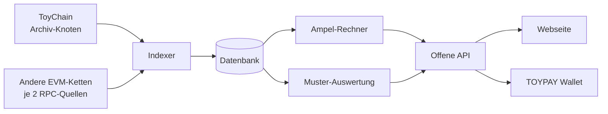

# ToyScan: Explorer, Warnampel und Anzeige anderer Ketten

Entwurf v0.2 vom 18.10.2026 · Grundlage: Spezifikation v0.3, Entscheidungen 56, 58, 60, 61 bis 112 · Status: **zur Prüfung** · Die frühere Fassung mit Bridge- und Altbestand-Kriterien liegt in `spaeter/08-toyscan-v0.1-mit-bridge.md`

## 1. Ziel und Grundsätze

ToyScan ist der Explorer für ToyChain. Die **Warnampel** zeigt auf einen Blick, ob die festen Regeln der Kette eingehalten werden. Für jede Adresse zeigt ToyScan auch, was sie auf anderen EVM-Ketten hält.

1. **Nur lesen, nie Schlüssel** (Entscheidung 56). ToyScan kann nichts bewegen, sperren oder freigeben.
2. **Jeder kann nachrechnen.** Jede Zahl hat einen Beleg (Blocknummer, Block-Hash, Transaktion). Code offen unter MIT im Ordner `toyscan/`.
3. **Jeder kann ToyScan selbst betreiben.** Mehrere unabhängige Instanzen sind erwünscht. Die Ampel ersetzt keine eigene Prüfung.
4. **Nur endgültige Daten.** ToyChain nach 1 Block, andere Ketten über deren Markierung „finalized“.
5. **Ganzzahlen, kein Fließkomma.** Alles in kleinsten Einheiten, erst die Anzeige formatiert.
6. **Keine Überwachung der Besucher:** keine Anmeldung, keine Werbung, kein Tracking.

## 2. Aufbau

| Teil | Aufgabe |
|---|---|
| **Archiv-Knoten** | normaler ToyChain-Knoten mit voller Historie, außerhalb des 256-MB-Budgets |
| **RPC-Quellen anderer Ketten** | je Kette zwei unabhängige Quellen. API-Schlüssel nur auf dem Server, nie im Repository |
| **Ampel-Rechner** | prüft nach jedem endgültigen Block die Kriterien aus Abschnitt 4 |
| **Muster-Auswertung** | sucht auffälliges Verhalten (Ebene C der Schutzregeln, Spezifikation Abschnitt 8) und erzeugt Warnungen |
| **Offene API und Webseite** | in den **45 Sprachen** von TOYQUEST 3D mit allen Erklärungen (`i18n/sprachen.tsv`, Entscheidung 103), Schalter „Erklärungen an/aus“, Rechts-nach-links für Arabisch, Urdu und Persisch, Grundansicht auch ohne JavaScript und auf alten Handys |

## 3. Daten vom Knoten

Der Knoten liefert über `toy_`-Methoden (M7). Beträge kommen als **Dezimalzahl in Textform** in kleinsten Einheiten, jede Antwort mit Blocknummer und Block-Hash.

| Methode | Inhalt |
|---|---|
| `toy_getSupply` | Obergrenze, gemintet, Summe aller Guthaben, Aktivierungs-Pfänder, Erstattungs-Pool, Lotterie-Töpfe, gesamter Stake |
| `toy_getEpoch` | Nummer, erster und letzter Block mit Zeitstempel, Faktor m mit Anteilen, Emission, Restmenge, Aufteilung |
| `toy_getBootstrap` | Startphase aktiv ja/nein, Start-Validatoren, Fortschritt zur Übergabe (Spezifikation 5.3) |
| `toy_getValidators` | Validatoren, Stake, Verfügbarkeit, Stufen-Zähler |
| `toy_getPenalties` | aktive Sperrzeiten mit Grund, Beweis und Ende |
| `toy_getConstitution` | feste Werte der Verfassung und ihr Hash |

## 4. Die Warnampel

### 4.1 Farben

| Farbe | Bedeutung |
|---|---|
| 🟢 Grün | erfüllt |
| 🟡 Gelb | Auffälligkeit ohne Regelbruch, z. B. Konzentration von Stake, veraltete Daten, Muster-Warnung |
| 🔴 Rot | Regel nachweislich gebrochen, mit Beleg |
| 🚨 Große rote Lampe | Obergrenze, Fair Launch oder Verfassung verletzt |

**Gesamtfarbe:** Rot, wenn ein Kriterium rot ist. Sonst Gelb, wenn eines gelb ist. Sonst Grün.

### 4.2 Kriterien

| Nr. | Kriterium | Rechnung | Gelb | Rot |
|---|---|---|---|---|
| **A1** | Obergrenze und Summe aller Guthaben (I0) | gemintet ≤ 10^26. **Summe aller Guthaben**, aus dem Archiv-Knoten selbst aufsummiert, = gemintet. Kein Ruhe-Eintrag doppelt aufgeweckt, Summen der Ruhe-Schnappschüsse mitgezählt, nirgends wurde TOY vernichtet | — | verletzt, dazu große rote Lampe |
| **A2** | Fair Launch | Genesis-Block enthält **0 TOY**. Jedes TOY lässt sich auf eine Emission zurückführen | — | Guthaben ohne Emission gefunden, dazu große rote Lampe |
| **A3** | Emission nach Formel | Emission und m genau nach Spezifikation 9.1 nachgerechnet, `0,5 ≤ m ≤ 2,0`, Restmenge = 10^26 − Summe der Emissionen, Aufteilung 50/40/10 (in der Startphase sinkender Anteil der Start-Validatoren) | Summe der Emission mehr als 3 % vor oder hinter dem Plan nach echter Zeit | Abweichung von der Formel oder m außerhalb |
| **A4** | Epochen und Zeit | jede Epoche mindestens 1.440 Blöcke und mindestens 86.400 Sekunden, Zeitstempel steigen um mindestens 10 Sekunden | Zeitstempel weichen dauerhaft mehr als 5 Sekunden von unabhängigen Zeitquellen ab | Epoche zu kurz |
| **A5** | Verfassung | `toy_getConstitution` liefert den veröffentlichten Hash, alle Parameter im erlaubten Bereich | — | verletzt, dazu große rote Lampe |
| **A6** | Konsens-Gesundheit | Blöcke werden endgültig, Komitee vollständig, Reihenfolge im Block korrekt, gemeldete Transaktionen aufgenommen (Spezifikation 5.1a) | eine Adresse hält mehr als 1/10 des gebundenen Stakes (vor dem Deckel), die größten 3 zusammen mehr als 1/3, weniger als 21 aktive Validatoren nach der Startphase, Finalität stockt | ein Validator mit mehr als 1/3 des wirksamen Stakes |
| **A7** | Startphase | Lohn zu genau gleichen Teilen, sinkt nach Tagen Planzeit (nach 180 Tagen 0), hält den Deckel ein, ist 365 Epochen gebunden. Jede Übergabe-Bedingung wird einzeln angezeigt. Übergabe nach den Regeln aus Spezifikation 5.3. Hinweis: Ob „neue“ Validatoren wirklich andere Personen sind, kann ToyScan nicht beweisen, nur Auffälligkeiten melden. Einnahmen jedes Start-Validators öffentlich | Startphase dauert länger als 365 Epochen, oder Start-Validatoren halten zusammen mehr als 1/3 des gebundenen Stakes | ungleiche Verteilung, Lohn über dem Plan, ungebundener Lohn oder Übergabe durch Stake von Start-Validatoren |
| **A8** | Schutzregeln | jede Sperre hat einen gültigen Beweis und eine Dauer nach Spezifikation Abschnitt 8. Kein Guthaben wurde eingefroren | Muster-Warnungen (Abschnitt 5) | Sperre ohne Beweis, falsche Dauer oder Zugriff auf Guthaben |
| **A9** | Datenlage | beide Quellen einig, ToyChain-Daten jünger als 10 Minuten, andere Ketten jünger als 30 Minuten | Quellen uneinig oder Daten veraltet | — |

### 4.3 Große rote Lampe

Sie geht an, wenn A1, A2 oder A5 rot sind. ToyScan zeigt dann oben auf jeder Seite einen roten Balken mit Erklärung und Beleg. Die TOYPAY Wallet zeigt dieselbe Warnung und folgt einer Abspaltung, die die Verfassung bricht, nicht automatisch.

### 4.4 Verlauf

Jeder Farbwechsel wird mit Werten und Beleg gespeichert und bleibt öffentlich.

## 5. Muster-Auswertung (Ebene C)

ToyScan sucht nach Verhalten, das einen Angriff oder Missbrauch vorbereiten könnte. Es **warnt nur** und sperrt nie (Spezifikation Abschnitt 8).

| Muster | Hinweis auf |
|---|---|
| viele neue Konten aus derselben Quelle, kurz vor einer Belohnung | Sybil-Farm für Lotterie oder Kontingent |
| Zahlungen im Kreis zwischen jungen Konten | Ausnutzen des kostenlosen Kontingents |
| schnell wachsender Stake bei wenigen Adressen | Vorbereitung einer Übernahme des Komitees |
| auffällige Häufung von Losen mit ähnlichen Zeitmustern | GPU-Farm oder gestohlene Rechenleistung |
| Zeitstempel eines Vorschlagenden immer am Rand des Erlaubten | Versuch, Zeit zu verschieben |

Jede Warnung nennt die Regel, die Zahlen und die betroffenen Adressen. Die Regeln der Muster-Auswertung sind öffentlich. Bewährt sich ein Muster, kann es als feste Regel der Ebene A vorgeschlagen werden.

## 6. Andere Ketten

- **Adress-Ansicht:** Für jede Adresse zeigt ToyScan neben dem ToyChain-Konto die Guthaben derselben Adresse auf den unterstützten EVM-Ketten (z. B. Ethereum, Polygon), nur lesend, mit Quelle und Stand.
- **Klare Trennung:** Natives TOY steht nur unter ToyChain. Token mit dem Namen ToyCoin oder dem Ticker TOY auf anderen Ketten bekommen den Hinweis „Nicht ToyChain-TOY, nicht eintauschbar“ (Spezifikation Abschnitt 11).
- **Keine Bridge-Kriterien** im jetzigen Umfang. Sie kommen mit einer späteren Bridge dazu.

## 7. Ansichten

| Seite | Inhalt |
|---|---|
| **Start** | Gesamtampel, Obergrenze, gemintet, Epoche, m, Emission dieser Epoche, Ist im Vergleich zum Plan, Stand der Startphase |
| **Blöcke, Transaktionen, Adressen** | Suche, jede Transaktionsart verständlich beschrieben, Adressen mit anderen Ketten |
| **Epochen** | Emission, Anteile von m, Aufteilung, Lotterie-Gewinner |
| **Erstattungs-Pool** | Stand, Zuflüsse (Emission, Gebühren, Kürzungen, Spenden), Abflüsse für kostenlose Transaktionen, Liste der Spenden |
| **Teilnehmer** | Anzahl je Stufe, Validatoren, Stake-Verteilung, Verfügbarkeit |
| **Validator-Bewertung** | je Validator: Verfügbarkeit, verpasste Signaturen, Strafen, Anteil für den Validator, delegierter Stake. Hilft beim Delegieren (Entscheidung 100) |
| **Netzwerk-Karte** | Anzahl der Knoten nach Land und Anbieter (grob, ohne IP-Adressen), Versionen, Anteil der größten Anbieter. Gelb, wenn ein Anbieter mehr als 1/3 der Knoten stellt |
| **Konto-Schutz** | wartende Abhebungen mit Tresor-Verzögerung, aktive Selbst-Sperren, offene Hash-Zeitschlösser mit Ablauf, Erben-Fristen (nur für die eigene Adresse ausführlich, sonst als Zahl) |
| **Schutz** | aktive Sperrzeiten mit Beweis, Doppelsignaturen mit Anteil am Stake und berechneter Kürzung, Muster-Warnungen |
| **Ruhende Konten und Checkpoints** | Anzahl aktiver und ruhender Konten, Füllstand des Zustands, Ruhe-Schnappschüsse und Beweise für jedes ruhende Konto zum Herunterladen, Genesis-Hash, Checkpoints |
| **Regeln** | alle Formeln in einfacher Sprache mit Rechenbeispiel |

## 8. Offene API

JSON, Beträge als Text in kleinsten Einheiten und zusätzlich formatiert, jede Antwort mit Messpunkt.

| Pfad | Inhalt |
|---|---|
| `/api/v1/supply` | Obergrenze, gemintet, Umlauf |
| `/api/v1/ampel` | Gesamtfarbe, jedes Kriterium mit Werten und Beleg |
| `/api/v1/ampel/verlauf` | Farbwechsel |
| `/api/v1/epoch/{n}` | Daten einer Epoche |
| `/api/v1/address/{adresse}` | ToyChain-Konto und andere Ketten |
| `/api/v1/warnungen` | aktuelle Muster-Warnungen |
| `/api/v1/netzwerk` | Netzwerk-Angaben (Chain-ID, Name, Symbol, RPC-Adressen, Explorer) im Format von EIP-3085 für das Eintragen per Klick |
| `/api/v1/checkpoints` | Checkpoints mit allen Signaturen der unabhängigen Stellen |
| `/api/v1/beweis/{adresse}` | Beweis für ein ruhendes Konto (Spezifikation 6.2) |
| `/api/v1/alarm` | Adress-Alarm abonnieren, ohne Anmeldung: Benachrichtigung per Web-Push, RSS oder Webhook bei jeder Bewegung einer Adresse (Entscheidung 100) |
| `/api/v1/daten` | offene Daten: tägliche Downloads aller Blöcke, Epochen und Kennzahlen für Forschung und Presse |
| `/api/v1/supply/circulating.txt` | eine Zahl für Listing-Seiten |

**Umlauf** = gemintet − gebundener Stake − Aktivierungs-Pfänder − Erstattungs-Pool − Lotterie-Töpfe. Der gesamte Bestand (gemintet) wird zusätzlich angezeigt. Auf ToyChain wird nie TOY verbrannt.

## 9. Betrieb

- Offizielle Instanz plus möglichst mindestens zwei unabhängige Instanzen. Die Wallet fragt mehrere ab und warnt bei Widerspruch.
- Die Wallet prüft A3 und A5 zusätzlich selbst. A1 (Summe aller Guthaben) kann nur ein Voll- oder Archiv-Knoten selbst nachrechnen.
- Ein kleines unabhängiges Prüfskript (z. B. in Python) rechnet A1 bis A4 aus Rohdaten nach. Ein Fehler müsste dann in zwei Programmen zugleich stecken.

## 10. Pflicht-Tests

- Für jedes Kriterium ein Fall Grün, Gelb (falls vorhanden) und Rot mit erfundenen Testdaten.
- Werte über 10^26 oder über `u128` lösen die große rote Lampe aus, statt abzustürzen.
- Epoche mit 10-Sekunden-Blöcken: A4 bleibt grün, solange 24 Stunden eingehalten sind.
- Zwei Quellen liefern verschiedene Werte: Gelb, kein Rot.
- Ein Block wird vor der Endgültigkeit ersetzt: die Ampel ändert sich nicht.
- Rust-Rechner und Prüfskript kommen bei denselben Rohdaten zum selben Ergebnis.
