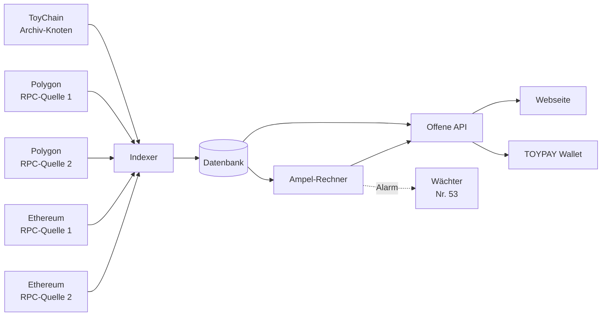

# ToyScan: Explorer und Ampel

Entwurf v0.1 vom 17.10.2026 · Grundlage: Spezifikation 12, `04-toyscan-und-altbestand.md`, `05-gesamtsystem.md` (Regeln I1 bis I6), `06-bridge.md` (Regeln B-I1 bis B-I4), Entscheidungen 13, 14, 41 bis 54 · Status: **zur Prüfung, offene Punkte in Abschnitt 11**

## 1. Ziel und Grundsätze

ToyScan ist der Explorer für ToyChain und zeigt dazu den Zustand der ToyCoin-Token auf Polygon und Ethereum. Die **Ampel** fasst zusammen, ob alle Regeln für die Menge eingehalten werden.

1. **Nur lesen.** ToyScan hat keine Schlüssel und keine Sonderrechte auf irgendeiner Kette. Es kann nichts bewegen, nichts sperren und nichts freigeben.
2. **Jeder kann nachrechnen.** Jede Zahl auf der Seite hat einen **Beleg**: Blocknummer, Block-Hash und Transaktion, aus der sie stammt. Die Regeln stehen in diesem Dokument, der Code ist offen (MIT, Ordner `toyscan/`).
3. **Jeder kann ToyScan selbst betreiben.** Es soll mehrere unabhängige Instanzen geben. Die Ampel ersetzt keine eigene Prüfung.
4. **Nur endgültige Daten.** Gezählt werden nur Blöcke, die auf ihrer Kette als endgültig gelten (ToyChain nach 1 Block, Polygon und Ethereum über die Markierung „finalized“ ihrer Knoten). So springt die Ampel nicht durch kurzfristige Umsortierungen.
5. **Ganzzahlen, kein Fließkomma.** Alle Rechnungen laufen in kleinsten Einheiten (10^-18 TOY). Erst die Anzeige formatiert als Dezimalzahl.
6. **Keine Überwachung der Besucher.** Keine Anmeldung, keine Werbung, kein Tracking, keine Cookies außer für die Spracheinstellung.

## 2. Aufbau



| Teil | Aufgabe |
|---|---|
| **Archiv-Knoten** | ein normaler ToyChain-Knoten, der die ganze Historie behält. Er unterliegt nicht dem 256-MB-Budget (Spezifikation 4). Den Speicherbedarf misst der Lasttest in M10 |
| **Zwei unabhängige RPC-Quellen je Fremdkette** | z. B. ein eigener Knoten und ein öffentlicher Anbieter. Weichen sie voneinander ab, gilt das Ergebnis als unsicher (Abschnitt 5.4). API-Schlüssel der Anbieter liegen nur auf dem Server, nie im Repository (`SECURITY.md`) |
| **Indexer** | liest Blöcke, Transaktionen und Ereignisse und legt sie in der Datenbank ab |
| **Ampel-Rechner** | prüft nach jedem endgültigen Block alle Kriterien aus Abschnitt 5 |
| **Offene API** | liefert dieselben Daten wie die Webseite, maschinenlesbar (Abschnitt 7) |
| **Webseite** | Deutsch und Englisch, funktioniert auf alten Handys und ohne JavaScript für die Grundansicht |

## 3. Datenquellen

### 3.1 ToyChain

Der Knoten stellt die Daten über eigene RPC-Methoden mit dem Präfix `toy_` bereit, zusätzlich zur Ethereum-Teilmenge aus M7. Alle Beträge kommen als **Dezimalzahl in Textform** in kleinsten Einheiten, z. B. `"100000000000000000000000000"`. Eine JSON-Zahl würde bei so großen Werten ungenau. Jede Antwort enthält Blocknummer und Block-Hash.

| Methode | Inhalt |
|---|---|
| `toy_getSupply` | Obergrenze, gemintet `G`, Reserve `R` (gesperrt und frei), Deckungsposten `C`, Bug-Bounty-Topf, Bridge-Konto `K_P` und `K_E`, Erstattungs-Pool |
| `toy_getEpoch` | Nummer der Epoche, erster und letzter Block, Faktor m mit seinen drei Anteilen (Auslastung, Leistung, Zeitplan), Emission dieser Epoche, Restmenge |
| `toy_getReserve` | Sperrstatus, bisher freigegeben, nächste Freigabe |
| `toy_getBridge` | Summen der Ausgänge und Eingänge je Kette, benutzte Nummern, offene und verzögerte Überweisungen, genutzte Limits, Stand der Ethereum-Freischaltung |
| `toy_getGovernance` | Vorschläge, Stimmen, Stufe der Mitbestimmung, aktuelle Parameter und ihre erlaubten Bereiche |
| `toy_getConstitution` | die festen Werte der Verfassung (`09-mitbestimmung.md`, Abschnitt 2) und ihr Hash |
| `toy_getCommittee` | Start-Komitee, Validatoren, unabhängiger Stake im Vergleich zum Stake des Start-Komitees (Nr. 37), Bridge-Komitee und Wächter |

Der Knoten berechnet diese Werte aus Zählern, die er ohnehin führt. Es kommt kein neuer Speicher hinzu. Die Größe wird trotzdem im Größentest von M5 mitgemessen.

### 3.2 Polygon und Ethereum

| Was | Wie gelesen |
|---|---|
| Gesamtmenge der Token | `totalSupply()` am Altbestand-Vertrag |
| Bestände | `balanceOf()` für Ersteller-Adresse, offizielle Cold-Wallets, Tresor, Burn-Adresse `0x…dEaD`, Gebühren-Adresse und Wechselstube des Spiels |
| Bewegungen | `Transfer`-Ereignisse von und zu den oben genannten Adressen |
| Code | `eth_getCode` für Altbestand-Verträge, Tresore und Verifizierer. Verglichen wird der Hash mit dem veröffentlichten Sollwert und die Liste der Funktionen (`04-toyscan-und-altbestand.md`, Abschnitt 2) |
| Tresor | Ereignisse für Freigaben, Einzahlungen, benutzte Nummern, Pausen und Komitee-Unterschriften. Zeitpunkt des letzten geprüften Beweises |

Werte von Polygon und Ethereum sind `uint256`. ToyScan liest sie als 256-Bit-Zahl. Passt ein Wert nicht in `u128`, ist das bereits ein Verstoß (Gesamtmenge über 10^26), und die große rote Lampe geht an.

## 4. Der Messpunkt

Jede Ampel-Rechnung bezieht sich auf einen **Messpunkt**: den letzten endgültigen Block von ToyChain, Polygon und Ethereum zum selben Zeitpunkt. Der Messpunkt wird mit den drei Blocknummern gespeichert.

**Überweisungen unterwegs stören die Rechnung nicht:**
- *ToyChain → Polygon:* Das TOY liegt schon im Bridge-Konto, der Tresor hat noch nicht freigegeben. `K_P` ist dann größer als nötig, `U_P ≤ K_P` hält.
- *Polygon → ToyChain:* Die Token liegen schon im Tresor, das TOY ist noch nicht gutgeschrieben. `U_P` ist dann kleiner, `U_P ≤ K_P` hält ebenfalls.

Die Deckungsregeln I3 und B-I1 werden durch die Wartezeit also nie fälschlich rot. Nur die Regel B-I2 verbindet zwei Ketten als Gleichung. ToyScan prüft sie deshalb als „höchstens“ (Freigaben ≤ bewiesene Ausgänge) und listet die offenen Posten einzeln auf. Die übrigen Gleichungen beziehen sich jeweils auf eine einzige Kette und werden genau geprüft.

## 5. Die Ampel

### 5.1 Farben

| Farbe | Bedeutung |
|---|---|
| ⚪ **Grau** | Kriterium noch nicht aktiv, z. B. Bridge vor dem Start |
| 🟢 **Grün** | erfüllt |
| 🟡 **Gelb** | Abweichung ohne Regelbruch, z. B. Quellcode noch nicht verifiziert, Bridge pausiert, Daten veraltet oder Quellen uneinig |
| 🔴 **Rot** | Regel nachweislich gebrochen, mit Beleg |
| 🚨 **Große rote Lampe** | die Obergrenze ist in Gefahr (Abschnitt 5.3) |

**Gesamtfarbe:** Rot, wenn ein aktives Kriterium rot ist. Sonst Gelb, wenn eines gelb ist. Sonst Grün. Graue Kriterien zählen nicht mit. Jede Ampel gibt es **je Kette** (ToyChain, Polygon, Ethereum) und als Gesamtampel.

### 5.2 Die Kriterien

Abkürzungen wie in `05-gesamtsystem.md`, Abschnitt 6: `G` gemintet, `R` Reserve mit Bug-Bounty-Topf (990.000), `C` Deckungsposten (10.000), `K_P`/`K_E` Unterkonten des Bridge-Kontos, `U_P`/`U_E` Umlauf auf Polygon/Ethereum, `F_P` Fremdbestand am Stichtag, `A` Freigaben, `D` Einzahlungen in den Tresor, `e` Nummer der Epoche.

| Nr. | Kriterium | Rechnung | Gelb | Rot | aktiv ab |
|---|---|---|---|---|---|
| **A1** | Obergrenze auf ToyChain (I1) | `G + R + C ≤ 10^26` | — | verletzt, dazu große rote Lampe | Mainnet |
| **A2** | Tresore decken den Rest | Tresor-Bestand `≥ Ersteinzahlung + ΣD − ΣA`, errechnet aus den Ereignissen des Tresors | — | Tresor hält weniger, Token haben ihn also ohne Freigabe verlassen | Bridge-Start der Kette |
| **A3** | Reserve | gesperrt `= 900.000 TOY − freigegeben(e)`, Formel unten. Bug-Bounty-Topf und Deckung wie im Genesis-Block, jede Auszahlung des Topfs mit Beleg | Auszahlung über 5.000 TOY ohne passende Abstimmung (siehe T1) | mehr freigegeben als der Plan erlaubt | Mainnet |
| **A4** | Emission nach Formel | Emission der Epoche `= floor(Restmenge × k₀ × m)` im Ganzzahl-Format des Knotens, `0,5 ≤ m ≤ 2,0`, Epoche genau 1.440 Blöcke | Summe der Emission mehr als 2 % vor dem Plan (Plan = dieselbe Rechnung mit m = 1) | Emission weicht von der Formel ab oder m liegt außerhalb | Mainnet |
| **A5** | Altbestand-Verträge und Tresore | Code-Hash und Funktionsliste unverändert, `totalSupply() = 10^26`, Tresor- und Verifizierer-Code gleich dem geprüften Stand | Quellcode noch nicht verifiziert | Code oder Gesamtmenge geändert, dazu große rote Lampe | sofort |
| **A6** | Bridge betriebsbereit | Notschalter aus. Kein Ausgang wartet länger als 2 × Takt (Polygon: 24 Stunden) auf seinen Beweis | pausiert oder Beweis überfällig | — | Bridge-Start der Kette |
| **A7** | Fremdbestand | gemessener Umlauf `U = totalSupply − Tresor − Ersteller − Cold-Wallets − Burn`. Vor dem Bridge-Start: `U_P ≤ 10.000`, `U_E = 0` | vor dem Stichtag über dem Deckungsposten | nach dem Stichtag gewachsen, ohne dass der Tresor freigegeben hat | sofort |
| **A8** | Erlaubte Abgänge | jeder `Transfer` von Ersteller-Adresse oder offizieller Cold-Wallet geht nur an eine offizielle Cold-Wallet, an den Tresor oder zurück an die Ersteller-Adresse (Nr. 44) | — | jeder andere Abgang | sofort, bis zur Tresor-Einzahlung |
| **A9** | Deckung über alle Ketten (I2 bis I6) | `K = C + ΣAusgang − ΣEingang`, `U_P + U_E ≤ K`, gemessenes `U_P` = errechnetes `F_P + A_P − D_P`, `F_P ≤ C`, Umlauf aller Ketten `≤ G + R + C ≤ 10^26` | — | eine Regel verletzt | Mainnet |
| **A10** | Bridge je Kette (B-I1 bis B-I4) | `U_P ≤ K_P`, `U_E ≤ K_E`. Freigaben ≤ bewiesene Ausgänge. Eingänge ≤ Unterkonto. Keine Nummer doppelt | — | eine Regel verletzt | Bridge-Start der Kette |
| **A11** | Verfassung | `toy_getConstitution` liefert den veröffentlichten Hash. Alle Parameter liegen in ihrem erlaubten Bereich | — | Verfassung geändert oder Parameter außerhalb, dazu große rote Lampe | Mainnet |
| **A12** | Datenlage | beide RPC-Quellen je Kette stimmen überein. Letzter endgültiger Block auf ToyChain jünger als 10 Minuten, auf Polygon und Ethereum jünger als 30 Minuten | Quellen uneinig oder Daten veraltet | — | sofort |

**Freigabeplan der Reserve (A3):** ToyScan und der Knoten rechnen gleich (Vorschlag, wird in M1 festgelegt):

```
freigegeben(e) = 0                                         für e ≤ 1.095
freigegeben(e) = floor(900.000 × 10^18 × min(e − 1.095, 1.095) / 1.095)   sonst
```

Weil immer die **Gesamtsumme** gerundet wird und nicht jede einzelne Rate, ergibt die letzte Epoche genau 900.000 TOY. Kein Rundungsrest bleibt hängen, und es wird nie zu viel freigegeben. Das Zwischenergebnis (ca. 9,9 × 10^26) passt in `u128`.

**Direkte Geschenke an den Tresor:** Schickt jemand Token per einfachem `transfer` an den Tresor statt über die Einzahlung, wird das gemessene `U` kleiner als das errechnete, ohne dass ein Eingang auf ToyChain folgt. Das schadet niemandem, es erhöht nur die Deckung. ToyScan zeigt es als Hinweis, die Ampel bleibt grün. Ist das gemessene `U` dagegen **größer** als das errechnete, sind Token am Tresor vorbei in Umlauf gekommen: Rot (A7, A9).

### 5.3 Große rote Lampe

Sie geht an, wenn **eine** dieser Bedingungen mit Beleg erfüllt ist:

1. Auf irgendeiner Kette gibt es mehr als 100.000.000 ToyCoin (`totalSupply() > 10^26` oder `G + R + C > 10^26`).
2. Der Code eines Altbestand-Vertrags, Tresors oder Verifizierers hat sich geändert, sodass Nachprägen nicht mehr ausgeschlossen ist.
3. Die Verfassung wurde geändert (A11), z. B. durch eine Abspaltung der Kette.

Dann zeigt ToyScan oben auf jeder Seite einen roten Balken mit Erklärung und Beleg. Die TOYPAY Wallet zeigt dieselbe Warnung und folgt einer Abspaltung, die die Verfassung bricht, nicht automatisch (`09-mitbestimmung.md`, Abschnitt 2).

### 5.4 Alarm an die Wächter

ToyScan selbst kann nichts pausieren. Wird ein Kriterium rot, schickt der Ampel-Rechner sofort einen Alarm an die Wächter (Nr. 53). Ein Mensch prüft den Beleg und löst bei Bedarf den Notschalter aus (siehe T2).

### 5.5 Verlauf

Jeder Farbwechsel wird mit Messpunkt, Kriterium, Werten und Beleg gespeichert und bleibt öffentlich. Wer später wissen will, warum die Ampel am 3. März gelb war, findet es dort.

## 6. Ansichten

| Seite | Inhalt |
|---|---|
| **Start** | Gesamtampel und Ampeln je Kette, Obergrenze, gemintet, Reserve (gesperrt/frei), Bug-Bounty-Topf, Deckung, Bridge-Konto, Umlauf je Kette, aktuelle Epoche, m, Emission dieser Epoche, Ist im Vergleich zum Plan |
| **Blöcke, Transaktionen, Adressen** | Suche nach Adresse, Transaktion oder Block. Jede Transaktionsart aus Spezifikation 6a mit verständlicher Beschreibung, z. B. „Stimme abgegeben“ |
| **Epochen** | Emission je Epoche, Anteile von m, Verteilung auf Konsens, Arbeit und Erstattungs-Pool |
| **Reserve** | Freigabeplan als Grafik, bisher freigegeben, Auszahlungen des Bug-Bounty-Topfs mit Begründung |
| **Bridge** | offene, verzögerte und abgeschlossene Überweisungen, genutzte Limits, Notschalter, Komitee und Wächter mit ihren Unterschriften, Ethereum: Stand der Freischaltung |
| **Altbestand** | beide Token-Verträge, Verteilung (Tresor, Ersteller, Cold-Wallets, Fremdbestand, Burn), jede Bewegung der überwachten Adressen |
| **Mitbestimmung** | Vorschläge mit Fristen, Stimmen, Quorum, Stimmungsbilder, Hinweis auf auffällige Häufungen gleichartiger Konten (`09-mitbestimmung.md`, Abschnitt 4) |
| **Komitee** | Start-Komitee und Fortschritt der Übergabe (Nr. 37), Bridge-Komitee mit Wahlterminen (Nr. 53) |
| **Spiel-Konten** | Gebühren-Adresse und Wechselstube auf Polygon, gesperrte 10 TOY je NFT im NFT-Vertrag (`07-toypay.md`) |
| **Ablauf und Checkpoints** | Genesis-Hash, Checkpoints, Ablauf-Snapshots jeder Epoche zum Herunterladen (Spezifikation 4) |
| **Regeln** | dieses Dokument in einfacher Sprache, mit jeder Formel und einem Rechenbeispiel |

## 7. Offene API

Alle Antworten als JSON, Beträge als Text in kleinsten Einheiten und zusätzlich formatiert. Jede Antwort enthält den Messpunkt.

| Pfad | Inhalt |
|---|---|
| `/api/v1/supply` | Obergrenze, gesamt, gemintet, Reserve, Umlauf (Definition unten) |
| `/api/v1/ampel` | Gesamtfarbe, Farbe je Kette, jedes Kriterium mit Werten und Beleg |
| `/api/v1/ampel/verlauf` | Farbwechsel mit Belegen |
| `/api/v1/epoch/{n}` | Daten einer Epoche |
| `/api/v1/bridge` | Unterkonten, Umlauf, offene Posten, Limits, Notschalter |
| `/api/v1/address/{adresse}` | Kontostand und Transaktionen |
| `/api/v1/supply/circulating.txt` | eine einzige Zahl für Listing-Seiten wie CoinGecko |

**Umlauf für Listing-Seiten**, ohne doppelte Zählung:

```
Umlauf = TOY auf ToyChain ohne Bridge-Konto und ohne gesperrte Reserve
       + U_P + U_E
```

Das Bridge-Konto bleibt draußen, weil seine TOY schon als Token auf Polygon oder Ethereum gezählt werden. Bug-Bounty-Topf und freigegebene Reserve sind enthalten, werden aber zusätzlich als „davon Projekt-Konten“ ausgewiesen.

## 8. Betrieb und Unabhängigkeit

- **Offizielle Instanz** des Projekts plus mindestens **zwei unabhängige Instanzen** anderer Betreiber. Die Wallet fragt mehrere Instanzen ab und warnt, wenn sie sich widersprechen.
- **Die TOYPAY Wallet rechnet selbst mit:** Die wichtigsten Regeln (A1, A4, A11) prüft der eingebaute Light-Knoten selbst und vergleicht sie mit ToyScan.
- **Zweite Umsetzung:** Neben dem Ampel-Rechner in Rust gibt es ein kleines unabhängiges Prüfskript (z. B. in Python), das dieselben Regeln aus den Rohdaten nachrechnet. Ein Fehler müsste dann in zwei verschiedenen Programmen gleichzeitig stecken.
- **Kein Geheimnis im Code:** RPC-Schlüssel, Server-Zugänge und der Schlüssel für die Alarme liegen nur auf dem Server.

## 9. Stufen der Einführung

| Stufe | Wann | Was |
|---|---|---|
| **0 · Altbestand-Wächter** | so bald wie möglich, vor dem Mainnet | A5, A7, A8, A12 für Polygon und Ethereum. Zeigt jede Bewegung der Ersteller-Adresse und der Cold-Wallets und das Messprotokoll am Stichtag (`05-gesamtsystem.md`, Schritte 0 und 6) |
| **1 · Explorer** | Mainnet-Start (Schritt 9) | dazu A1, A3, A4, A9, A11, Blöcke, Epochen, Reserve, Mitbestimmung. Bridge-Kriterien grau |
| **2 · Bridge Polygon** | Bridge-Start (Schritt 12) | A2, A6, A10 für Polygon |
| **3 · Bridge Ethereum** | nach der Freischaltung per Abstimmung (Schritt 12a, Nr. 52) | A2, A6, A10 für Ethereum |

## 10. Pflicht-Tests

- Für **jedes Kriterium** ein Fall Grün, Gelb (falls vorhanden) und Rot mit erfundenen Testdaten, keine echten Schlüssel.
- Überweisungen unterwegs in beide Richtungen, auch über eine Epochengrenze: die Ampel bleibt grün.
- Freigabeplan: Summe über alle 1.095 Freigabe-Epochen ergibt genau 900.000 TOY, nie mehr.
- Werte über `u128` und über 10^26 lösen die große rote Lampe aus, statt das Programm abstürzen zu lassen.
- Zwei RPC-Quellen liefern verschiedene Werte: Gelb, kein Rot.
- Ein Block wird vor der Endgültigkeit ersetzt: Die Ampel ändert sich nicht.
- Rust-Rechner und Prüfskript kommen bei denselben Rohdaten zum selben Ergebnis.

## 11. Offene Punkte

**T1 · Prämien des Bug-Bounty-Topfs über 5.000 TOY:** Laut `09-mitbestimmung.md` braucht so eine Prämie eine Abstimmung. Soll das **Protokoll** das erzwingen (die Mehrfachsignatur-Transaktion muss dann auf einen angenommenen Vorschlag verweisen, sonst ist sie ungültig) oder reicht es, dass **ToyScan** einen Verstoß gelb anzeigt? *Empfehlung:* vom Protokoll erzwingen. Das ist eine kleine Prüfung, und niemand muss sich auf die Ehrlichkeit der Unterzeichner verlassen.

**T2 · Automatisch pausieren?** Soll ToyScan bei Rot die Bridge selbst pausieren dürfen? *Empfehlung:* nein. ToyScan bleibt ohne Schlüssel und alarmiert nur die Wächter. Eine Software, die selbst pausieren kann, wäre ein neues Ziel für Angreifer, und ein Fehlalarm würde alle Nutzer treffen.

**T3 · Stufe 0 vorziehen?** Der Altbestand-Wächter braucht ToyChain noch nicht. Er könnte als kleines eigenes Programm **vor** den übrigen Meilensteinen entstehen und die Ersteller-Adresse und die Cold-Wallets sofort öffentlich überwachen (`05-gesamtsystem.md`, Schritt 0). *Empfehlung:* ja, als erster kleiner Baustein im Ordner `toyscan/`.
