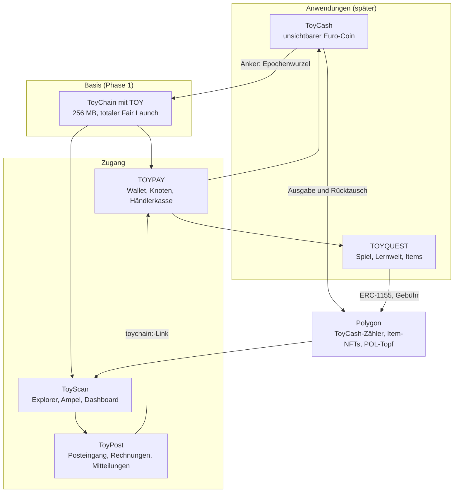
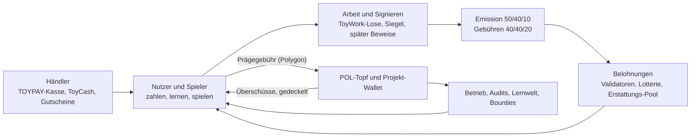

# ToyVerse: das Ökosystem im Überblick

Stand 24.10.2026 · **Konzept für später**, ändert nichts an Phase 1 · Quelle: „ToyVerse: Beschreibung in 20 Seiten“, Entwurf vom 21.10.2026, dazu die Konzeptblätter zu ToyCash und TOYQUEST vom 21.10.2026 · Entscheidungen 122 bis 130 (`../02-entscheidungen.md`)

**ToyVerse** ist der Name für alles zusammen: ToyChain, ToyCoin (TOY), TOYPAY, ToyScan, ToyCash, TOYQUEST und ToyPost, samt Wirtschaftskreislauf und Community (Entscheidung 122). Dieses Dokument verbindet die Teile. Die Einzelheiten stehen in den verlinkten Dokumenten.

## 1. Wichtig: Was bei ToyChain und ToyCoin gilt

Die 20-Seiten-Beschreibung enthält an einigen Stellen den Stand **vor** der Neuausrichtung vom 18.10.2026. Für ToyChain und ToyCoin gelten unverändert die Spezifikation v0.3 und das Entscheidungsprotokoll. Diese Stellen wurden **nicht** übernommen:

| In der Beschreibung | Es gilt | Entscheidung |
|---|---|---|
| Fair Launch mit 1 % Reserve (1 Mio. TOY, bis 100 Wallets, 4 Jahre Sperre) | **totaler Fair Launch:** Genesis ohne Guthaben, keine Reserve, alle 100 Mio. per Emission | 62 |
| Emission 99 Mio., erste Epoche ca. 49.950 TOY | 100 Mio. per Emission, erste Epoche **50.500 TOY**, erstes Jahr rund 16,84 Mio. | 62, 113 |
| Konten unter 0,1 TOY werden entfernt, Ablauf nach 1001 Tagen | Konten gehen **nie** verloren: Aktivierungs-Pfand, ruhende Konten mit Aufwecken | 73 bis 75 |
| Altbestand mit Tresoren, Bridge 1:1, zk-Light-Client | alte ToyCoin-Token werden **ignoriert**, keine Bridge im jetzigen Umfang | 63 |
| Bonus bis 1,5-fach mit Wurzel-Deckel | Belohnung **linear** plus Grundbetrag, Deckel je Teilnehmer | 111, 112 |
| Layer-2-Token, NFTs, Smart Contracts „nicht in Phase 1“, EVM-Ausführung in Phase 5 | auf ToyChain **nie**: nur TOY, nur fest eingebaute Transaktionsarten | 36 |
| ToyChain-Phasen 1 Kern, 2 Beweise, 3 Privatsphäre, 4 Offline, 5 Bridge und EVM | Phase 1 Testnet (M1 bis M13), Phase 2 Beweise, danach Reihenfolge offen | Spezifikation 15 |
| Hybrid-Signaturen mit ML-DSA | Post-Quanten-Zusatzschlüssel in M13 | 96 |
| TOYPAY nur Android, 28 Sprachen | Android, Windows, Linux, Raspberry Pi, **45 Sprachen**, vier Modi | 30, 103, 104 |
| Passkeys und Social Recovery in TOYPAY | nur für den **Polygon-Smart-Account**. Das ToyChain-Konto bleibt bei Nr. 82 und 83 | 128 |

Neu aus der Beschreibung sind dagegen ToyCash, die TOYQUEST-Items mit POL-Topf, Lernwelt und Zeitreise, das Wirtschafts-Dashboard und die Community-Bausteine.

## 2. Drei Ebenen

| Teil | Aufgabe | Dokument | Stand |
|---|---|---|---|
| **ToyChain, TOY** | Konten, Konsens, Emission, Kontingent, Notar für ToyCash | `../01-spezifikation.md` | Phase 1, M3 fertig (20.10.2026) |
| **TOYPAY** | Wallet und Knoten mit Stufen, später ToyCash-Bereich, Gutscheine, Prägen | `../04-toypay-wallet.md` | Konzept, Bau M8/M9 |
| **ToyScan** | Explorer, Ampel A1 bis A9, später ToyVerse-Ampel B1 bis B4 und Wirtschafts-Dashboard | `../05-toyscan.md` | Konzept, Bau M11 |
| **ToyCash** | Euro-Stablecoin mit Client-Side Validation, offline, Gutscheine | `12-toycash.md` | für später |
| **TOYQUEST** | Spiel, Items als NFT auf Polygon, Lernwelt und Zeitreise | `13-toyquest-items-nft.md`, `../../toypay/docs/08_LERNWELT_ZEITREISE.md` | für später |
| **ToyPost** | Korrespondenz, TOY-Rechnungen, Betrugsschutz, Mitteilungen in 45 Sprachen | `10-toypost-schnittstelle.md`, Repository `Safehaigit/toypost` | gebaut, Schnittstellen als Vorschlag |

Dokufy gehört nicht zum ToyVerse. ToyPost nutzt nur dieselbe technische Grundlage.

## 3. Wie die Teile zusammenspielen

**Eine Beispielreise:**

1. Eine Spielerin lernt in der Akademie von TOYQUEST, was ein Arbeitsnachweis ist (Demo).
2. Sie aktiviert in TOYPAY ToyWork, nur bei Ladekabel und WLAN.
3. Ihr Gerät reicht Lose für die Arbeits-Lotterie ein. Die Edelsteinmine im Spiel zeigt jeden Fund. Ein Gewinn bringt mindestens 0,2 TOY, davon 0,1 TOY als Aktivierungs-Pfand.
4. Später bezahlt sie im Laden mit ToyCash offline. Der Händler löst vor Ablauf der Rückholfrist ein, die Siegel landen in der nächsten Epochenwurzel auf der ToyChain.
5. Jeder kann in ToyScan Emission, Ampel und ToyCash-Gesundheit prüfen, ohne ihren Namen oder Betrag zu sehen.
6. ToyPost schickt ihr eine Rechnung als `toychain:`-Link oder warnt sie vor einer Phishing-Nachricht, die nach ihrer Phrase fragt.

**Schnittstellen zwischen den Teilen:**

| Von → nach | Was | Regel |
|---|---|---|
| ToyChain → TOYPAY, ToyScan, ToyPost | JSON-RPC (`eth_*`, `toy_*`, ab M7) | nur lesend für ToyScan und ToyPost |
| ToyCash → ToyChain | Transaktionsart **Anker** (Hash, Zähler, kein Betrag) | Vorschlag Nr. 124, nach M13 |
| ToyCash → Polygon | Zähler für Ausgabe und Rücktausch | Summen öffentlich, Einzelbeträge nie |
| TOYPAY → TOYQUEST | signierter Stufen-Nachweis (EIP-191) plus ToyScan-Daten | nie Schlüssel (Nr. 32) |
| TOYQUEST → Polygon | Mint-Gutschein, `permit`, Paymaster | `13-toyquest-items-nft.md` |
| ToyScan → ToyPost | Ampel, Adress-Alarm, später ToyVerse-Ampel | Webhook signiert (Vorschlag) |
| ToyPost → TOYPAY | `toychain:`-Link, Anmelden mit Adresse | ToyPost hat keine Schlüssel |

## 4. Wirtschaftskreislauf

Jeder soll sehen können, woher Wert kommt und wohin er fließt. Die Zahlen der ToyChain sind die der Spezifikation v0.3.

| Fluss | Regel | Quelle |
|---|---|---|
| Emission | 50 % Konsens, 40 % Arbeit, 10 % Erstattungs-Pool. In der Startphase sinkender Lohn der 21 Start-Validatoren | Spezifikation 9 |
| Gebühren | 40 % Gebühren-Lotterie, 40 % Erstattungs-Pool, 20 % Vorschlagender | Spezifikation 7.2 |
| Erstattungs-Pool | behält höchstens 30 Epochen der größtmöglichen Erstattung, der Überschuss geht in die Arbeits-Lotterie. Gebühr mit Faktor bis 1.024, ein ToyWork-Los macht eine Transaktion gebührenfrei | Nr. 117, 119, 120 (M3) |
| Prägegebühr | mindestens 1× Gaskosten in den Topf, Rest per Regler zwischen Topf und Projekt-Wallet. Kein Burn | Nr. 126 |
| Überschüsse | anteilig an alle, die geprägt haben, gedeckelt auf die eigene Einzahlung, als Rabatt oder Auszahlung | Nr. 126 |
| Projekt-Wallet | finanziert Betrieb, Audits, Lernwelt, Bug-Bounties und Community-Ersteller. **Keine Reserve aus der Kette** | Nr. 62, 130 |
| Händler | Kasse in TOYPAY, stabile Euro-Preise mit ToyCash, Gutscheine und Treue | Nr. 125, 130 |

**Was es nicht gibt:** keine Reserve, kein Premint, kein Verbrennen auf der ToyChain (Nr. 74), keine Renditeversprechen.

### 4.1 Eine Wertschöpfungskette als Beispiel

| Schritt | Beitrag | Ergebnis |
|---|---|---|
| 1 | Spieler lernen und spielen in TOYQUEST | Verständnis, Items, Dukaten |
| 2 | Sie prägen Items als NFT und zahlen die Gebühr | Topf und Projekt-Wallet gefüllt |
| 3 | Der Topf zahlt das Gas, Überschüsse fließen zurück | kostenloses Prägen ohne POL, Rabatte |
| 4 | Die Projekt-Wallet finanziert Betrieb und Audits | bessere Lernwelt, sichere Verträge |
| 5 | Teilnehmer rechnen und signieren im Netzwerk | Anteil an Emission und Gebühren |
| 6 | Händler nehmen TOY und ToyCash an | Nachfrage, stabile Preise, Treueaktionen |

### 4.2 Wirtschafts-Dashboard

ToyScan zeigt den Kreislauf als Bild mit echten Zahlen aus Kette und Verträgen: wer Wert schafft (Arbeit, Signieren, Lernen, Spielen, Händler), wer zahlt und wohin es fließt. Keine Prognosen, keine Renditen (`../05-toyscan.md`, Abschnitt 11).

## 5. Community und Mitbestimmung

| Baustein | Was dahintersteckt | Status |
|---|---|---|
| Mentoren | erfahrene Spieler werden Lehrmeister für Neue, bekommen Wissens-Siegel und Dukaten | Vorschlag |
| Gilden und Gangs | auch außerhalb des Spiels: gemeinsame Kassen über Gruppen-Gutscheine, Events wie ein Halving-Fest (zur Halbwertszeit der Emission) | Vorschlag |
| Community-Knoten | Raspberry-Pi-Pakete, Knotenkarte in ToyScan, Belohnung über die normalen Stufen | Vorschlag |
| Händler-Ökosystem | TOYPAY-Kasse, Gutscheine, Treuepunkte, Euro-Preise mit ToyCash, Verzeichnis geprüfter Händler | Vorschlag |
| Ersteller und Entwickler | geprüfte Community-Items mit Anteil an der Prägegebühr, Bug-Bounties aus der **Projekt-Wallet** (nicht aus einer Reserve), offene Standards (ERC-1155) | Vorschlag |
| Mitbestimmung | kommt später (Nr. 64). Die Beschreibung schlägt Gewichtung nach Aktivität und Wissen vor, nicht nur nach Besitz. Das würde Nr. 47 (Wurzel aus Stake) ablösen, wenn Mitbestimmung entschieden wird | Vorschlag |

**Ohne Admin-Schlüssel:** Abstimmungen sind Signale an Entwickler und Teilnehmer. Protokoll-Updates brauchen Signalisierung, Wartezeiten und Audits. Die Verfassung (Spezifikation 13) kann niemand ändern.

**ToyPost** bildet die Community als Kontaktgruppen ab (Tester, Validatoren, Mentoren, Händler, Knotenbetreiber, Gilden) und verschickt Mitteilungen nur nach Freigabe.

**Offene Fragen:** Wie wird Wissen gewichtet, etwa über Wissens-Siegel? Wie lassen sich Mentoren-Belohnungen vor Scheinkonten schützen? Welche Rechte haben Ersteller, wie werden Community-Items geprüft? Wie viele Community-Knoten braucht es?

## 6. Sicherheit über alle Teile

Schichten von außen nach innen: **Mensch** (Phrase nie weitergeben, Warnungen, die weise Warnerin im Spiel, ToyPost-Betrugsschutz), **Betrieb** (Audits, Fuzzing, reproduzierbare Builds, Bug-Bounty), **Verträge** (kein Admin, Limits, Notschalter nur zum Pausieren), **Konsens** (Stake-Deckel, Kürzung, Checkpoints, Dandelion++), **Kryptografie** (nur geprüfte Verfahren, Krypto-Agilität, ML-DSA als Zusatz).

**Neue Gefahren durch das ToyVerse und Gegenmittel:**

| Gefahr | Gegenmittel |
|---|---|
| Gestohlener Schlüssel des Spielservers prägt massenhaft | Tageslimit im Mint-Vertrag, einmalige Gutscheine, Notschalter nur Pause |
| Topf wird leergesaugt | verifizierender Paymaster mit Gas-Richtlinien, Gebühr über Gaskosten, Limits je Wallet |
| Emittent zeigt zwei Siegel-Listen | Epochenwurzel als Anker auf der ToyChain, Merkle-Beweis je Note |
| Euro-Reserve fehlt | signierte Berichte, Testzahlungen, ToyScan-Kriterium B1, später Föderation |
| Offline-Doppelausgabe | Offline-Kaution, Identifizierung bei Betrug, Rückholfrist |
| Inhaber-Gutschein-Codes werden abgefangen | gelten als Geheimnis, nie im Klartext über unsichere Kanäle, PIN und Limits |
| Falsche Prägeseiten, falsche ToyCash-Angebote, „Topf-Auszahlung“ als Köder | Warnliste in TOYPAY, Muster in ToyPost, Erklärungen der weisen Warnerin |
| Verwechslung alter ToyCoin-Token mit TOY | Hinweis „Nicht ToyChain-TOY, nicht eintauschbar“ überall (Nr. 63) |

**Pflicht-Freigaben:** kein Mainnet, keine echten Euro und keine echten Prägungen ohne externes Audit, Testnet mit Lasttests und rechtliche Prüfung (MiCA, E-Geld, Steuer, Gutscheine mit Geldwert, Glücksspielrecht). Die rechtliche Prüfung liegt bewusst am Schluss.

## 7. Fahrplan im ToyVerse

Reihenfolge, keine Termine. Jede Stufe braucht Messungen und Prüfungen.

| Strang | Schritte | Voraussetzung |
|---|---|---|
| ToyChain | Phase 1 Testnet (M1 bis M13), dann Phase 2 Beweise, danach Reihenfolge offen | – |
| ToyScan | Bau mit M11, ToyVerse-Ampel und Dashboard danach | M11 |
| ToyCash | 1 Prototyp mit Test-Euro, 2 Offline-Wallet, 3 zk-Notes, 4 Compliance und Föderation | 1 läuft neben dem Testnet, 2 braucht die Anker-Transaktion, 3 Phase 2 |
| TOYQUEST | Lernwelt im Demo-Modus jederzeit, echte Stufen ab Testnet. Items auf Polygon unabhängig vom ToyChain-Kern, sobald Nr. 127 entschieden ist | Audit von Mint-Vertrag und Paymaster |
| ToyPost | gebaut. Neue ToyScan-Daten und ToyCash-Hinweise, sobald es sie gibt | – |
| Community | Dashboard und Bausteine, sobald Daten und Nutzer da sind | Testnet |

**Schon jetzt ohne Umbau vorgesehen:** ToyChain-Transaktionen haben einen Typ (EIP-2718), damit kommt die Anker-Transaktion ohne Umbau dazu. ToyCash-Notes und alle ToyVerse-Datenformate bekommen von Anfang an ein Versionsfeld und `asset_id`.

## 8. Offene Punkte

1. Währung und Kurs der Prägegebühr (Nr. 127).
2. Anker-Transaktion bestätigen und einplanen (Nr. 124).
3. Stufenwerte des Offline-Rahmens, Fristen der Rückholung (Nr. 125).
4. Regler-Rahmen, Pool, Kollektion, Überschuss-Regeln für TOYQUEST (Nr. 126).
5. Orte, NPC-Rollen und Maschinen-Zuordnung im ersten Release (Nr. 129).
6. Community-Fragen aus Abschnitt 5 (Nr. 130).
7. Marke und Domain für ToyCash und ToyVerse.
8. Rechtliche Prüfung vor jedem echten Geld, bewusst am Schluss.
