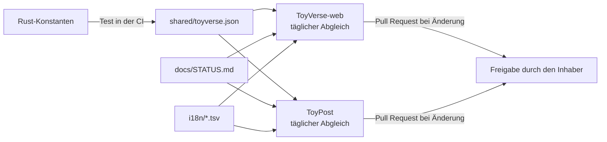

# Verknüpfung und Kompatibilität im ToyVerse

Stand 24.10.2026 · Bestandsaufnahme aller Repositories, gemeinsame Datenverträge und automatischer Abgleich · Entscheidung 135 (Vorschlag)

Dieses Dokument beschreibt, wie die Projekte technisch zusammenhängen, welche Programmiersprachen beteiligt sind, welche Daten sie teilen und wie der Stand automatisch abgeglichen wird. Die fachlichen Anwendungsfälle stehen in `11-toyverse.md` und `14-toysafe.md`.

## 1. Projekte, Sprachen und Laufzeiten

| Projekt | Repository | Sprache und Laufzeit | Plattformen | Stand |
|---|---|---|---|---|
| ToyChain-Knoten | `TOYfoundation/toycoin`, `toychain/` | Rust, Edition 2024, mindestens 1.87, gebaut mit 1.97.0 (festgenagelt) | Linux x86_64, Windows x86_64, Linux aarch64, armv7 (optional), Android als Bibliothek | M1 bis M3 fertig |
| TOYPAY-Wallet | `toycoin/toypay/` (App-Code folgt) | Rust-Kern aus dem Workspace, Oberfläche Kotlin mit Compose Multiplatform (Vorschlag), Anbindung UniFFI | Android, Windows, Linux, Raspberry Pi | Konzept, Bau M8/M9 |
| TOYQUEST 3D | `toycoin/toypay/godot3d/` | GDScript, Godot 4.4 | wie TOYPAY | Katalog, Effekte, Tests |
| Werkzeuge | `toycoin/toypay/tools/`, `docs/anhang/`, `docs/whitepaper/` | Python 3 | Entwickler-PC | in Gebrauch |
| ToyScan | `toycoin/toyscan/` | Rust (geplant) | Server | Konzept, Bau M11 |
| ToySafe | noch offen (`14-toysafe.md`, S6) | Rust-Kern `toy-safe`, Oberfläche wie TOYPAY (Vorschlag) | Android, Desktop, Kommandozeile | Konzept |
| ToyPost | `TOYfoundation/Toypost` | TypeScript 5.9, Node 22.18 oder neuer (CI: Node 24), App mit Expo 54 und React Native 0.81.5 | Server, Android, iOS, Web | gebaut |
| Webseite | `TOYfoundation/ToyVerse-web` | Astro 7.3.8, JavaScript und TypeScript, Node 22.12 oder neuer (CI: Node 24) | statisch | 22 von 45 Sprachen |

**Ergebnis:** Die Sprachen sind gut verträglich, weil sie nur über **Textformate** (JSON, TSV, Markdown-Tabellen) und später über **JSON-RPC** miteinander sprechen. Kein Projekt ruft Code eines anderen direkt auf, außer TOYPAY und ToySafe, die den Rust-Kern über UniFFI einbinden. So bleibt jedes Projekt allein lauffähig.

## 2. Gemeinsame Datenverträge

| Vertrag | Quelle | Nutzer | Format |
|---|---|---|---|
| **Feste Werte** | `shared/toyverse.json`, erzeugt aus den Rust-Konstanten | Webseite, ToyPost, ToySafe, TOYPAY, ToyScan, Werkzeuge | JSON, Schema `toyverse/1` |
| Sprachen und Begriffe | `i18n/sprachen.tsv`, `i18n/begriffe.tsv` | alle Oberflächen | TSV mit `\|` |
| Projektfortschritt | Tabelle „Überblick Meilensteine“ in `docs/STATUS.md` | Webseite (Roadmap), ToyPost (Mitteilungen) | Markdown-Tabelle, Spalten Meilenstein, Inhalt, Status (✅ = fertig) |
| Knotendaten | JSON-RPC `eth_*`, `toy_*` | TOYPAY, ToyScan, ToyPost, ToySafe | ab M7 |
| ToyScan-Daten | `/api/v1/ampel`, `/supply`, `/address/{a}`, `/alarm` | ToyPost, ToySafe, Webseite | ab M11 (`../05-toyscan.md`) |
| Zahlungslink | `toychain:<adresse>?betrag=&zweck=` | ToyPost, TOYPAY, ToySafe | `10-toypost-schnittstelle.md` |
| Signaturen | EIP-155 (Transaktionen), EIP-191 (Nachrichten, Prüf-Freigabe), EIP-4361 (Anmelden), EIP-712 (lesbare Anfragen) | alle | Standards |
| Transaktionsformat | EIP-2718 mit Typ-Bytes `0x70` bis `0x77`, dazu Ethereum Legacy und Typ 2 | TOYPAY, ToySafe, ToyScan | `toyverse.json` → `txKinds` |
| Warnliste | `toysafe-warnliste/1` | TOYPAY, ToyScan, ToyPost, ToySafe | `14-toysafe.md`, Abschnitt 6.3 |

## 3. Zahlen und Formate je Sprache

TOY-Beträge sind ganze Zahlen in kleinsten Einheiten bis 10²⁶. Das ist größer als 2⁵³ und größer als 2⁶³. Darum gilt in **jedem** Datenformat: **Beträge als Dezimal-Text** (z. B. `"100000000000000000"` für 0,1 TOY), nie als Zahl und nie als Fließkomma.

| Sprache | Typ für Beträge | Hinweis |
|---|---|---|
| Rust | `u128` (`toy_types::Amount`) | rechnet mit `checked_*` |
| TypeScript/JavaScript | `bigint` | `Number` verliert ab 2⁵³ Stellen. ToyPost macht es richtig (`packages/shared/src/toy/amount.ts`) |
| Kotlin | `java.math.BigInteger` | `Long` reicht nur bis rund 9,2 TOY in kleinsten Einheiten |
| Python | `int` | beliebig groß |
| GDScript | `String` oder ganze TOY als `int` | `int` ist 64 Bit, also höchstens rund 9,2 TOY in kleinsten Einheiten. Das Spiel rechnet darum nur in ganzen TOY oder Dukaten |

Weitere Regeln: Adressen mit Prüfsumme nach EIP-55, Hashes als `0x` plus Kleinbuchstaben-Hex, Anteile als Millionstel (`…Ppm`), Zeiten in Sekunden, Texte nur als Schlüssel mit Übersetzung in 45 Sprachen.

## 4. Die Datei `shared/toyverse.json`

Eine einzige Quelle für alle festen Werte: Ticker, Dezimalstellen, Obergrenze, Chain-IDs, Blockzeit, Epoche, Emission, Gebühren, Kontingent, Aktivierungs-Pfand, Stufen, ToyWork, Typ-Bytes der Transaktionen, die alten ToyCoin-Token (Nr. 63), Sprachen und Grundregeln (nur TOY, nie verbrennen, Konten verfallen nie, kein Premint, nie nach der Phrase fragen).

- **Erzeugt, nicht getippt:** Der Test `toychain/tests/tests/toyverse_manifest.rs` baut die Datei aus den Rust-Konstanten und schlägt fehl, wenn die Datei im Repository abweicht. Neu erzeugen: `UPDATE_TOYVERSE_JSON=1 cargo test -p toy-integration-tests --test toyverse_manifest`.
- **Versioniert:** Feld `schema`. Neue Felder dürfen dazukommen. Umbenennen oder Entfernen erhöht die Version.
- **Nutzer prüfen gegen die Datei:** ToyPost und die Webseite haben je einen Test, der ihre eigenen Werte (z. B. Dezimalstellen, alte Token, Chain-ID) mit ihrer Kopie der Datei vergleicht.

## 5. Automatischer Abgleich

1. In toycoin hält die CI `shared/toyverse.json` mit dem Rust-Code gleich.
2. Webseite und ToyPost haben je einen Workflow „Abgleich mit toycoin“. Er läuft täglich und auf Knopfdruck, holt toycoin (`main`), startet das Abgleich-Skript und öffnet bei Änderungen einen Pull Request. Die normale CI prüft ihn, zusammengeführt wird von Hand.
3. **Einmalig nötig, weil alle Repositories privat sind:** ein Lese-Schlüssel (fine-grained Personal Access Token, nur „Contents: Read-only“ für `TOYfoundation/toycoin`) als Secret `TOYCOIN_READ_TOKEN` in `ToyVerse-web` und `Toypost`. Dazu unter „Settings → Actions → General“ das Häkchen „Allow GitHub Actions to create and approve pull requests“. Ohne Schlüssel überspringt der Workflow den Abgleich und sagt das im Protokoll.

## 6. Befunde der Bestandsaufnahme vom 24.10.2026

| Nr. | Befund | Folge | Maßnahme |
|---|---|---|---|
| K1 | Abgleich lief nur von Hand (Skripte `sync-toycoin.mjs`, `toy-i18n-sync.mjs`) | Stand konnte veralten | täglicher Workflow mit Pull Request (Abschnitt 5) |
| K2 | ToyPost hatte noch die Begriffsliste vom Stand `a5c7349`: es fehlten die 10 ToyVerse-Begriffe | Übersetzungen in ToyPost unvollständig | abgeglichen, jetzt automatisch |
| K3 | Feste Werte doppelt: Dezimalstellen und alte Token in ToyPost, Chain-ID 7630714 in den Texten der Webseite | Abweichung möglich | `toyverse.json` plus Vergleichstests |
| K4 | `toypay/godot3d/scripts/nft_items.gd` rechnet mit den Präge-Regeln der Entscheidungen 19 bis 26 (Mindestbestand 100 TOY, Gebühr nach Wert). Nr. 126 ersetzt die Gebühr durch die Gas-Formel, Nr. 127 (Währung und Kurs) ist offen | Spiel zeigt veraltete Präge-Kosten | **nicht geändert**, wartet auf Nr. 127 (Vorschlag V10 in `11-toyverse.md`) |
| K5 | ToyPost nutzt eigene Umsetzungen von Keccak-256 und secp256k1 | eigene Krypto widerspricht der Regel „nur geprüfte Bibliotheken“ | offen seit 19.10.2026: Tausch gegen `@noble/hashes` und `@noble/curves`, sobald die Paketquelle erreichbar ist |
| K6 | Überblick in `11-toyverse.md` nannte für die Webseite noch „Deutsch und Englisch“ | veraltet | aktualisiert (22 von 45 Sprachen) |
| K7 | GDScript kann Beträge in kleinsten Einheiten nicht als Zahl halten | Rundungs- oder Überlauffehler möglich | Regel in Abschnitt 3, Werte im Spiel nur ganze TOY oder Text |
| K8 | ToySafe fehlte im Überblick | Lücke bei Sicherheit über alle Teile | `14-toysafe.md`, Entscheidung 134 |

## 7. Verknüpfungs-Übersicht

| Von → nach | Verbindung | Stand |
|---|---|---|
| toycoin → Webseite | Sprachen, Begriffe, Meilensteine, feste Werte | automatisch (dieser Stand) |
| toycoin → ToyPost | Sprachen, Begriffe, Meilensteine, feste Werte | automatisch (dieser Stand) |
| ToyChain → TOYPAY, ToyScan, ToyPost, ToySafe | JSON-RPC | ab M7 |
| ToyScan → ToyPost, ToySafe | Ampeln, Alarm, signierte Webhooks | ab M11 |
| ToySafe ↔ TOYPAY | Risiko-Prüfung vor dem Signieren, Konto-Schutz-Assistent | Vorschlag, ab M8 und M12 |
| ToySafe → ToyPost | Warnungen, Prüfberichte | Vorschlag |
| ToyPost → TOYPAY | `toychain:`-Link, Anmelden mit Adresse | gebaut in ToyPost |
| TOYPAY → TOYQUEST | signierter Stufen-Nachweis | Vorschlag Nr. 129 |
| ToyCash → ToyChain | Anker | Vorschlag Nr. 124 |
| Webseite → alle | Erklärseiten, Verweise „Passt dazu“ | gebaut |
