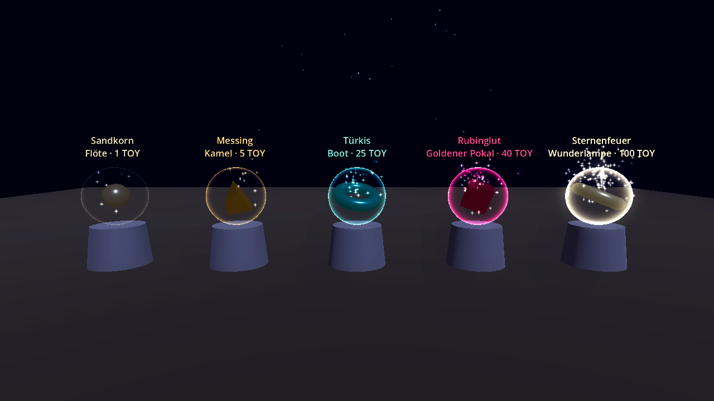
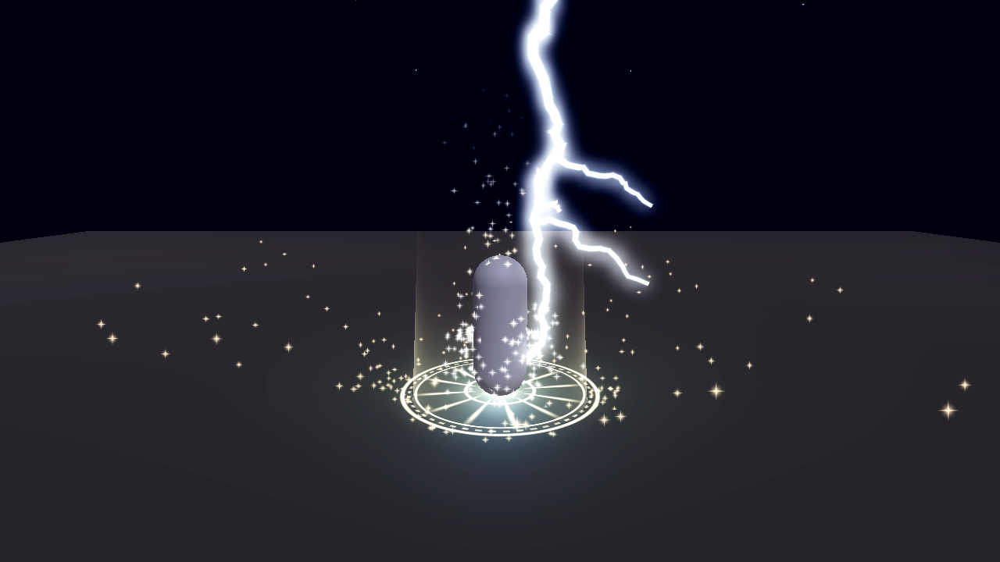
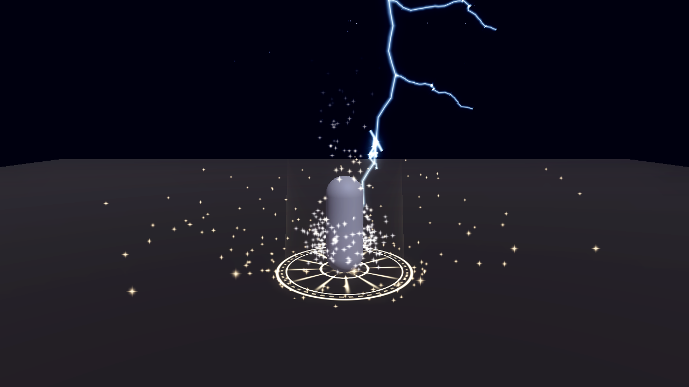
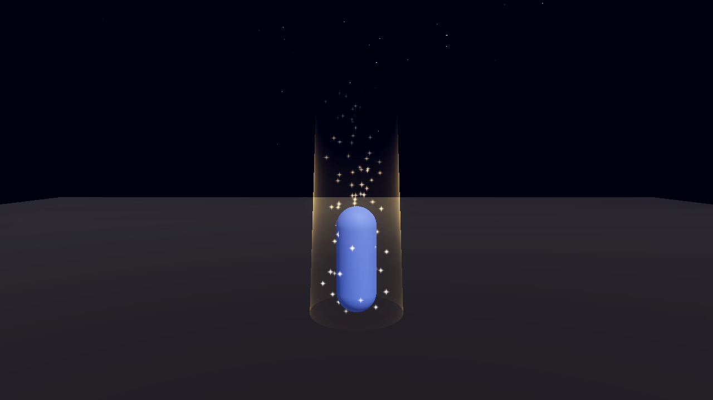
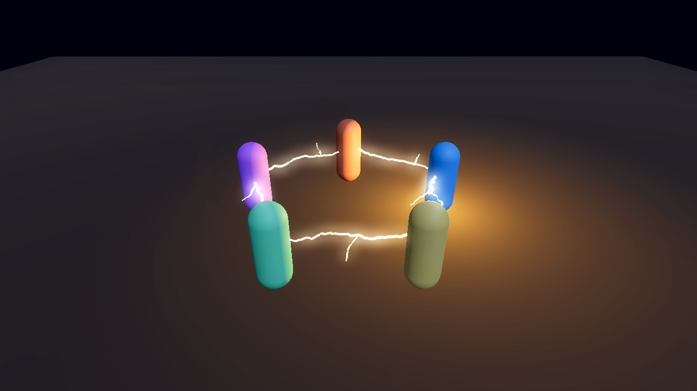

# Spieldesign: „Die Gang der 1001 Nächte“

Stand: 17.10.2026 · Gilt für TOYQUEST 3D und die 2D-Spiele · Baut auf den Entscheidungen 15 bis 32 auf (`docs/02-entscheidungen.md`, `docs/spaeter/07-toypay-spiel-und-nft.md`) · Status: **Entwurf zur Prüfung**. Alle Zahlen sind Startwerte für das Testspiel.

> **Für später (Entscheidung 72):** Das Spiel und seine NFT-Regeln sind nicht Teil des jetzigen Testnet-Baus. Die Präge-Regeln mit ToyCoin-Token auf Polygon gelten nicht mehr, weil diese Token derzeit ignoriert werden (Nr. 63).

## 1. Die Idee in drei Sätzen

Du startest als Niemand im Basar von Bagdad und baust dir Nacht für Nacht eine **Gang** aus bis zu fünf Spielfiguren, die sich in ihren Stärken ergänzen. Was die Gang kann, entsteht aus **Können und Zusammenspiel**, nie aus Geld. Wer eine Figur bis Stufe 20 gebracht hat, kann sie als NFT prägen. Sie gehört dann wirklich dem Spieler, mit Glitzer, Blitz und Siegel.

**Leitsätze**
1. **Können vor Geld.** TOY und Sultansdukaten kaufen nie direkt Stärke. Stärke kommt aus Stufe, Fähigkeiten und Gang-Synergien.
2. **Zusammenspiel vor Einzelkampf.** Die schweren Aufgaben brauchen verschiedene Figuren mit verschiedenen Stärken.
3. **Fairer Rhythmus.** Wochenlimits und Stufe 20 geben allen dasselbe Tempo. Wer eine Nacht verpasst, verliert nichts.
4. **Spaß sieht man.** Jede Leistung bekommt ein sichtbares, hörbares Echo: Licht, Glitzer, Blitz, Klang.

## 2. Spielschleifen

| Schleife | Dauer | Was passiert |
|---|---|---|
| **Kurz** | 2 bis 10 Minuten | Eine Aufgabe, eine Herausforderung oder ein Schatzfund. Belohnung: Erfahrung, Königsdukaten, Gegenstände im Spiel |
| **Mittel** | eine Nacht (ein echter Tag) | Die **Nachtgeschichte**: Scheherazade erzählt jede Nacht ein neues Kapitel mit 3 Aufgaben und einem Cliffhanger. Dazu der **Schatzwind** (Abschnitt 6) |
| **Lang** | eine Woche | Präge-Fenster: höchstens 1 Spielfigur und 10 Gegenstände. Gang-Mission der Woche. Wochenbasar mit Sonderhändlern |
| **Saison** | 101 Nächte (gut 14 Wochen) | Fünf Akte mit Bösewicht, Finale und Saisontitel (Abschnitt 3) |

**Kein Druck durch Serien:** Die Nachtgeschichte merkt sich, wo du warst. Verpasste Nächte kannst du nachholen, ohne Strafe. Serien geben kleine Zierboni (Glitzerspur, Titel), nie Stärke. Das ist bewusst so gewählt, weil schon 16-Jährige spielen.

## 3. Spannungsbogen einer Saison: „101 Nächte“

| Akt | Nächte | Karte | Thema | Höhepunkt |
|---|---|---|---|---|
| **I · Der Staub von Bagdad** | 1–20 | Basar von Bagdad, Trainingsoase | Ankommen, erste Figur, erste Gegenstände | Der Gewürzschmuggler **Hassan Halbmond** stiehlt den Dattelpokal. Verfolgungsjagd über die Dächer |
| **II · Wüstennacht** | 21–40 | Wüstennacht | Reiten, Ausdauer, Sterne lesen | Sandsturm. Die Karawane muss nach den Sternen navigieren. Wer die Sternwarte gemeistert hat, ist im Vorteil |
| **III · Das Wasser der Oasen** | 41–60 | Oase | Schwimmen, Tauchen, Erfindungen | Der Wasserwerk-Saboteur legt die Noria lahm. Die Gang repariert sie gegen die Zeit |
| **IV · Der Räuberwald** | 61–80 | Räuberwald | Heimlichkeit, Kampf, Bündnisse | Die **Vierzig Schlafmützen** (eine Räuberbande, die tagsüber schläft) planen den großen Coup. Nachts schleichen, tagsüber zuschlagen |
| **V · Die Schatzhöhle** | 81–100 | Schatzhöhle | alles zusammen | Der Wesir **Ja'far Glasauge** will die Wunderlampe. Gang-Mission mit fünf Rollen |
| **Finale · Die 101. Nacht** | 101 | alle Karten | Sternenfest | Feuerwerk aus Blitzen und Glitzer über Bagdad. Saisontitel, Ehrenplatz im Kodex |

**Bogen in jedem Akt:** Einführung (Nächte 1–5) → Steigerung mit neuen Herausforderungen (6–14) → Wendung, bei der der Bösewicht etwas Unerwartetes tut (15) → Aktfinale als Gang-Mission (16–20). Danach eine ruhige Nacht im Teehaus mit Rückblick und Ausblick.

## 4. Steigende Anforderungen

### Stufen und Erfahrung

- **Erfahrung bis zur nächsten Stufe:** `EP(n) = 100 × n^1,6`. Stufe 20 braucht insgesamt rund 87.000 EP. Bei 10 bis 14 Nächten mit je einer Stunde sind das gut 6.000 bis 9.000 EP pro Spielstunde.
- **Ziel für die erste Figur:** Stufe 20 in **10 bis 14 Nächten** bei etwa einer Stunde Spiel pro Tag.
- **Mentor-Bonus:** Jede schon geprägte Figur gibt neuen Figuren derselben Gang +15 % Erfahrung, höchstens +45 %. Spätere Figuren holen also schneller auf. Die Wochengrenze bleibt trotzdem: höchstens eine neue Figur pro Woche.
- **Nach Stufe 20 geht es weiter** bis Stufe 50. Aufstiege werden auf der Kette festgehalten (Entscheidung 22), ab Stufe 20 alle 5 Stufen als **Meisterstufe** mit eigenem Lichteffekt.

### Fünf Schwierigkeitsränge

| Rang | Name | Stufen | Probe | Beispiel |
|---|---|---|---|---|
| I | **Lehrling** | 1–5 | eine Fähigkeit ≥ 2 | Dattelkörbe über drei Dächer tragen |
| II | **Geselle** | 6–10 | eine Fähigkeit ≥ 5 | Mit der Dioptra die Minaretthöhe auf 1 m genau messen |
| III | **Meister** | 11–15 | zwei Fähigkeiten ≥ 6 | Tauchen nach der versunkenen Wasseruhr, mit Luftvorrat und Strömung |
| IV | **Großmeister** | 16–20 | drei Fähigkeiten, zwei Figuren | Kamelrennen mit Hindernissen, während eine zweite Figur den Weg ausspäht |
| V | **Legende** | ab 20 | Gang mit mindestens drei Klassen | Palasteinbruch: Klettern 10, Heimlichkeit 8, Wissen 7, verteilt auf die Gang |

**Proben statt Würfel:** Eine Probe gelingt, wenn der Wert erreicht ist **und** der Spieler die Aufgabe geschickt löst: Timing, Zielen, Rätsel, Route. Werte senken die Schwierigkeit, nehmen sie aber nicht ab. So zählt Können immer mit.

### Gegenstände mit Stufenanforderung

Damit niemand Stärke kaufen kann, braucht jeder Gegenstand eine Mindeststufe, abgeleitet aus der Seltenheit:

| Seltenheit | Mindeststufe | Gebühr (TOY) |
|---|---|---|
| Sandkorn | 1 | 1–4 |
| Messing | 5 | 5–14 |
| Türkis | 10 | 15–39 |
| Rubinglut | 15 | 40–79 |
| Sternenfeuer | 20 | 80–100 |

Ein gekaufter Mondlicht-Krummsäbel nützt einer Figur auf Stufe 8 also nichts. Sie muss erst wachsen.

## 5. Klassen und Gang

### Acht Klassen

Jede Figur wählt beim Anlegen eine Klasse. Aussehen, Name und ein Teil der Startwerte werden dabei kostenlos gewürfelt. Der Spieler darf beliebig oft neu würfeln (K9, kein bezahlter Zufall).

| Klasse | Englisch | Stärken | Kniff (besondere Fähigkeit) | Gang-Aura |
|---|---|---|---|---|
| **Dachfuchs** | Rooftop Fox | Klettern, Heimlichkeit | *Katzensprung*: doppelte Sprungweite über Dächer | +1 Klettern für alle |
| **Wüstenblitz** | Desert Bolt | Reiten, Ausdauer | *Sandsprint*: kurzer Galopp mit Blitzspur | Reisezeit −15 % |
| **Basarzunge** | Bazaar Tongue | Handel, Ausstrahlung | *Feilschwalzer*: Preisrunde mit dem Händler | Ladenpreise −5 % (nur Königsdukaten) |
| **Sterngucker** | Stargazer | Wissen, Spürsinn | *Himmelsblick*: zeigt Schatzfunde in der Nähe | Rätsel geben +1 Hinweis |
| **Säbelwirbel** | Saber Whirl | Kampf, Schutz | *Wirbelhieb*: Rundumschlag mit Funkenkranz | +1 Schutz für alle |
| **Perlenhai** | Pearl Shark | Schwimmen, Spürsinn | *Tiefenatem*: doppelte Luft unter Wasser | Bootsfahrten +20 % schneller |
| **Schattenfeder** | Shadow Quill | Heimlichkeit, Spürsinn | *Nachtschritt*: kurz unsichtbar für Wachen | Fahndung sinkt doppelt so schnell |
| **Lautenzauber** | Lute Charmer | Ausstrahlung, Wissen | *Ohrwurm*: Wachen tanzen 5 Sekunden | Moral: +5 % Erfahrung für alle |

### Synergien

**Duos** (zwei bestimmte Klassen aktiv in der Gang):

| Duo | Klassen | Effekt |
|---|---|---|
| **Mitternachtsduo** | Dachfuchs + Schattenfeder | Heimlichkeitsproben +2 |
| **Goldkehlchen** | Basarzunge + Lautenzauber | Handel +2, Ausstrahlung +2 |
| **Sand und Salz** | Wüstenblitz + Perlenhai | Reisen zu Land und Wasser −20 % Zeit |
| **Sternensäbel** | Sterngucker + Säbelwirbel | Kampf +1 nachts, Gegner sichtbar auf der Minikarte |
| **Fliegende Händler** | Basarzunge + Wüstenblitz | Wochenbasar öffnet einen Sonderhändler |
| **Taucherglocke** | Perlenhai + Sterngucker | Unterwasserrätsel +2 Hinweise |
| **Dachkonzert** | Dachfuchs + Lautenzauber | Ablenkung: Wachen schauen nach oben |
| **Schild und Schatten** | Säbelwirbel + Schattenfeder | Hinterhalt-Schaden ×1,5 |

**Volle Karawane:** Fünf **verschiedene** Klassen aktiv geben +10 % auf alle Fähigkeiten und einen goldenen Blitzring um die Gang.

**Grenzen gegen Übermacht:** Boni derselben Fähigkeit summieren sich mit abnehmender Wirkung (voll, dann ×0,75, dann ×0,5). Je Figur und Fähigkeit gilt höchstens +12 aus Gegenständen.

### Gegenstands-Sets

Besitzt eine Adresse alle Teile eines Sets, gilt der Set-Bonus für die ganze Gang. Die Sets stehen in `toypay/data/gang.json`.

| Set | Teile | Bonus |
|---|---|---|
| **Garderobe des Wesirs** | Wesirsrobe, Goldenes Wesirsiegel, Turban mit Juwel | Ausstrahlung +3, Handel +2 |
| **Die vierzig Langfinger** | Diebesgewand, Schattenkapuze, Dietrichset, Lautlose Filzschuhe | Heimlichkeit +4 |
| **Karawane der Morgenröte** | Kamel, Kamelsattel mit Teppichauflage, Ledersatteltaschen, Kamelglocken | Reiten +2, Tragkraft +3 |
| **Sindbads Seekiste** | Matrosenkittel, Lateinersegel, Schwimmkompass, Seekarten des Indischen Ozeans | Schwimmen +3, Spürsinn +2 |
| **Sterndeuter von Bagdad** | Messing-Astrolab, Sternbestickte Astronomenrobe, Sterntafeln (Zidsch), Himmelsglobus | Wissen +4 |
| **Säbeltanz** | Damaszener Krummsäbel, Bemalter Mandelschild, Turbanhelm, Kettenhemd | Kampf +3, Schutz +2 |
| **Basar-Barone** | Messing-Händlerwaage, Abakus, Ledergebundenes Kassenbuch, Seidenbörse mit Quasten | Handel +4 |
| **Nächte der Musik** | Einfache Oud, Darbuka aus Ton, Ney-Rohrflöte, Fingerzimbeln | Ausstrahlung +4, Gang-Moral +5 % |
| **Fliegende Händler** | Fliegender Teppich, Gewürzkegel-Auslage, Sprechender Papagei | Handel +3, Reiten +2. Der Papagei ruft Angebote aus |
| **Erbe der Dschinn** | Wunderlampe, Ring des Dschinns, Leere Dschinnflasche | alle Fähigkeiten +1, Blitzkrone über der Gang |

### Gang-Ränge

| Rang | Englisch | Bedingung |
|---|---|---|
| **Straßenstaub** | Street Dust | Start |
| **Basarbande** | Bazaar Band | 2 aktive Figuren, 10 Aufgaben |
| **Karawanenclan** | Caravan Clan | 3 Figuren, 1 Set vollständig |
| **Wüstenlegende** | Desert Legend | 5 Figuren, 3 verschiedene Duos |
| **Sternenbund** | Star Covenant | Volle Karawane und das Saisonfinale bestanden |

Der Spieler gibt seiner Gang einen Namen. Ein Vorschlagsgenerator hilft, z. B. „Die Kamel-Kumpanen“, „Dattel-Diebe vom Dienstag“, „Die Sandsturm-Schwestern“, „Basar-Bande Bummelbart“.

## 6. Wirtschaft und Spieltheorie

### Quellen und Senken der Königsdukaten

| Quellen (rein) | Senken (raus) |
|---|---|
| Aufgaben und Herausforderungen | Reparatur von Waffen und Rüstung |
| Schatzfunde (nur mit geprägten Figuren) | Futter und Pflege für Reittiere |
| Meisterprüfungen | Miete fürs Gang-Versteck, Ausbau des Verstecks |
| Verkauf von Gegenständen an Händler (50 % des Ladenpreises) | Training bei Fachleuten (Lehrstätten) |
| | Schnellreise per Karawane, Teehaus-Runden für die Gang |

**Regel:** Pro Woche sollen die Senken 85 bis 95 % der Quellen aufnehmen. Der Spielserver misst das. Steigen die Preise trotzdem, sinken die Quellen leicht. So bleiben Königsdukaten etwas wert, ohne dass Sparer bestraft werden.

### Schatzwind

> **Hinweis vom 24.10.2026 (Entscheidung 126):** Nr. 23 ist ersetzt. Prägegebühren gehen jetzt in POL-Topf und Projekt-Wallet, Überschüsse an die Spieler, die geprägt haben (`../../docs/spaeter/13-toyquest-items-nft.md`). **Vorschlag:** Der Schatzwind wird aus der Spielwirtschaft gespeist. Seine Stärke richtet sich nach der Zahl der Prägungen und Meisterprüfungen der Vorwoche, nicht nach TOY-Beträgen, und Funde gibt es nur in Königsdukaten, Gold und Gegenständen. So bleibt der Kreislauf der Dukaten getrennt von Geld, und kein Fund sieht wie eine TOY-Ausschüttung aus. Die Angaben „Gegenwert 0,01 bis 2 TOY“ unten gelten dann nicht mehr.

Die Präge-Gebühren einer Woche speisen die Schatzfunde der nächsten (Haushaltsregel, Entscheidung 23). Im Spiel heißt das **Schatzwind**:
- Stärke 1 bis 5, sichtbar als glitzernder Staub in der Luft und als Fahne über dem Basartor.
- **Stärke 5 = Goldregen-Nacht**: Funkelnde Funde an logischen Orten wie Dachrinnen, Brunnenschächten, Höhlennischen und Schiffswracks.
- Funde im Gegenwert von 0,01 bis 2 TOY, ausgezahlt in Königsdukaten, Gold oder Gegenständen (Einbahnstraße, Entscheidung 25).
- **Spürsinn** zeigt Funde früher an. Ein Sterngucker sieht das Glitzern schon auf 40 m, alle anderen auf 15 m.

### Fair bleiben: Regeln gegen Ausnutzen

| Gefahr | Gegenmittel |
|---|---|
| **Bezahlen statt Spielen** (pay-to-win) | TOY und Sultansdukaten kaufen keine Stärke. Mindeststufen für Gegenstände. Grenze von +12 je Fähigkeit |
| **Bots, die Schätze farmen** | Funde liegen an schwer erreichbaren Orten und verlangen Geschick (Klettern, Tauchen, Rätsel). Höchstens 20 Funde je Figur und Nacht, an derselben Stelle mit sinkendem Wert |
| **Viele Konten** | 100 TOY Mindestbestand und 10 TOY Sperre je NFT (Entscheidungen 19 und 21), Stufe 20 vor dem Prägen |
| **Reiche werden immer reicher** | Abnehmender Ertrag beim Stapeln. Saisontitel nach Können (Bestzeiten, Meisterprüfungen), nie nach Besitz |
| **Trittbrettfahrer in Gruppen-Missionen** | Belohnung nach Beitrag: Wer seine Probe schafft, bekommt seinen Anteil |
| **Zu viele Legenden** | **Saison-Auflage (Nr. 46):** Je Gegenstandsart und Saison (101 Nächte) höchstens **1.001 Rubinglut** und **101 Sternenfeuer**. Dazu gilt für jede Sternenfeuer-Art insgesamt höchstens **1.001 Stück** (Nr. 33). Der Vertrag zählt Saisons ab einem festen Startzeitpunkt, ohne Admin. So erneuert sich die Knappheit jede Saison, ohne dass Legenden über die Jahre beliebig zunehmen |

### Bündnisse

Bis zu vier Spieler schließen sich zu einem **Karawanenbund** zusammen. Einmal pro Woche gibt es eine **Bund-Expedition**: vier Gangs, vier Rollen (Späher, Träger, Kämpfer, Rätsellöser). Kooperation lohnt sich mehr als Konkurrenz, weil die Belohnung nach Beitrag verteilt wird und es für vollständige Erfolge einen Bonus gibt.

### Ab 16 und ab 18

- **Unter 18:** volles Spiel mit Klassen, Gang, Akten, Königsdukaten und Gold. Kein Prägen, keine Sultansdukaten, keine Schatzfunde (die gibt es nur für geprägte Figuren). Als Ausgleich gibt es Saisonaufgaben mit gleich viel Erfahrung.
- **Ab 18 mit Altersnachweis und verbundener TOYPAY Wallet:** Prägen, Wechselstube, Schatzwind-Funde.
- **Poker** läuft nur mit **Basar-Chips**. Sie sind von Dukaten und TOY vollständig getrennt (K2).

## 7. Aussehen: Licht, Glitzer und Blitze

### Seltenheiten mit eigenem Licht

| Seltenheit | Englisch | Farbe | Effekt |
|---|---|---|---|
| **Sandkorn** | Sand Grain | Sandbeige `#C8B48A` | matter Schimmer, ein paar Staubkörner |
| **Messing** | Brass | Messinggold `#D9A441` | warmer Glanzstreifen, der über das Objekt wandert |
| **Türkis** | Turquoise | Türkis `#2EC4B6` | weiche Aura, langsame Glitzerpunkte |
| **Rubinglut** | Ruby Glow | Rubin `#E0115F` | pulsierende Glut, dichter Glitzer, Funken beim Aufheben |
| **Sternenfeuer** | Starfire | Weißgold `#FFE9A8` und Blau `#7FD4FF` | Sternenstaub-Regen, kleine Blitzbögen um das Objekt, Lichtsäule beim Prägen |

### Momente, die leuchten

| Moment | Effekt | Dauer |
|---|---|---|
| **Stufenaufstieg** | goldene Lichtsäule, aufsteigender Glitzer, Glockenklang | 1,5 s |
| **Meisterstufe** (25, 30, 35 …) | wie Stufenaufstieg, dazu ein Blitzring am Boden | 2 s |
| **Schatzfund** | Funkenfontäne in der Farbe der Seltenheit, Münzklingeln | 1 s |
| **Duo aktiviert** | Lichtband springt zwischen den zwei Figuren hin und her | 0,8 s |
| **Volle Karawane** | goldener Blitzring verbindet alle fünf Figuren | 2 s |
| **Die Prägung** | Sand wirbelt im Kreis, ein Siegel aus Licht senkt sich, Glitzerexplosion. Bei Sternenfeuer schlägt ein Blitz in das Siegel ein | 3 bis 4 s |
| **Goldregen-Nacht** | glitzernder Staub am Himmel, Sternschnuppen | ganze Nacht |

### So sieht es aus (gerendert mit Godot 4.4.1, OpenGL-Renderer)

Die Bilder stammen aus der Vorschau-Szene `godot3d/vfx/preview/vfx_showcase.tscn`. Statt echter Modelle stehen dort einfache Platzhalter-Formen, die Effekte sind echt.

| | |
|---|---|
|  |  |
| **Die fünf Seltenheiten**: von Sandkorn (dezent) bis Sternenfeuer (Sternenstaub und Blitzbögen) | **Die Prägung (Sternenfeuer)**: Lichtsiegel, Glitzerexplosion, Blitzeinschlag |
|  |  |
| **Dieselbe Prägung im Modus „Sanft“**: kein Lichtblitz, ruhigerer, dunklerer Blitz | **Stufenaufstieg**: goldene Lichtsäule mit aufsteigendem Glitzer |
|  | |
| **Volle Karawane**: Blitzring verbindet fünf Figuren | |

### Design-Grundsätze: smooth, crisp, fresh

- **Klar vor bunt:** Effekte rahmen das Wichtige ein. Text und Bedienelemente bleiben immer lesbar, mit Kontrast mindestens 4,5:1.
- **Weiche Bewegung:** Fenster gleiten mit 200 bis 300 ms und leichtem Nachschwingen ein. Nichts springt hart.
- **Eine Farbe, eine Bedeutung:** Die Seltenheitsfarben werden nur für Seltenheit verwendet. Gold für TOY und Sultansdukaten, Silber für Königsdukaten und Gold.
- **Rückmeldung mit allen Sinnen:** Licht, Klang und auf dem Handy eine kurze Vibration.
- **Leistung:** Auf Handy und Raspberry Pi (Qualität „Niedrig“) höchstens 64 Partikel je Effekt, keine Blitz-Geometrie, nur ein Glow. Auf dem PC („Hoch“) bis 512 Partikel und volle Blitze.

### Schutz bei Lichtempfindlichkeit (Pflicht)

Blitze und Flackern können bei fotosensibler Epilepsie Anfälle auslösen. Deshalb gilt:
- **Höchstens 3 Blitze pro Sekunde**, nach dem Grenzwert der WCAG-Richtlinie 2.3.1. Kein großflächiges rotes Blinken.
- Einstellung **„Blitze und Flackern“**: *Normal* / *Sanft* (Blitze werden zu weichem Leuchten) / *Aus*. Beim ersten Start fragt das Spiel danach, mit einem kurzen Hinweis.
- Das Effekt-Paket (`toypay/godot3d/vfx/`) hält diese Regeln selbst ein.

## 8. Namensgebung: Stil

- **Bildhaft und mit Augenzwinkern:** Namen sollen ein Bild im Kopf erzeugen und dürfen lustig sein („Die Hoheit mit den Höckern“), aber nie albern bei ernsten Dingen wie Geld, Alter oder Sicherheit.
- **Beinamen** für alle 77 kostbaren und legendären Gegenstände, z. B. Wunderlampe: *„Dreimal reiben, einmal staunen“*, Fliegender Teppich: *„Keine Warteschlange, kein Kamel“*, Weißes Königskamel: *„Die Hoheit mit den Höckern“*. Die Beinamen stehen in `toypay/data/nft_epithets.tsv`.
- **Aufgabennamen** mit Neugier-Effekt, zum Beispiel:
  - „Der Kamel-Klau von Kufa“
  - „Die Nacht der knarrenden Dielen“
  - „Der Wesir hat Schluckauf“
  - „Wettrennen um den Dattelpokal“
  - „Das Rätsel der singenden Wasseruhr“
  - „Wer hat den Mond in den Brunnen fallen lassen?“
  - „Sindbad hat seinen Kompass verlegt“
  - „Vierzig Schlafmützen und ein Wecker“
- **Kulturell respektvoll:** Die Welt stammt aus der Märchensammlung 1001 Nacht und der Wissenschaftsgeschichte. Religiöse Symbole werden nicht als Spielgegenstände oder für Witze verwendet.

## 9. Was davon schon gebaut ist

| Teil | Stand |
|---|---|
| Katalog mit Seltenheitsnamen, Farben, Mindeststufen, Beinamen | `toypay/data/`, erzeugt durch `gen_nft_items.py` |
| Klassen, Duos, Sets und Gang-Ränge als Daten | `toypay/data/gang.json` |
| Gang-Berechnung im Spiel (Sets, Duos, abnehmender Ertrag, Grenze +12) | `toypay/godot3d/scripts/nft_items.gd`, Test `nft_items_test` |
| Effekt-Paket: Seltenheits-Aura, Glitzer, Blitze, Präge-Zeremonie, Stufenaufstieg, Karawanen-Ring, Blitzschutz (höchstens 3 Blitze pro Sekunde, Modi Normal/Sanft/Aus), Qualitätsstufen | `toypay/godot3d/vfx/`, Test `vfx_test` (ALL OK), Vorschaubilder in `toypay/docs/bilder/` |
| Bekannte Kleinigkeiten | An sehr spitzen Knicken kann der Blitz eine kleine helle Ecke zeigen. Auf dem Raspberry Pi und alten Handys sind die Effekte noch nicht gemessen |
| Akte, Aufgaben, Schatzwind, Klassen-Kniffe im Spiel | **noch nicht**: braucht den Spielcode `godot3d/` |
